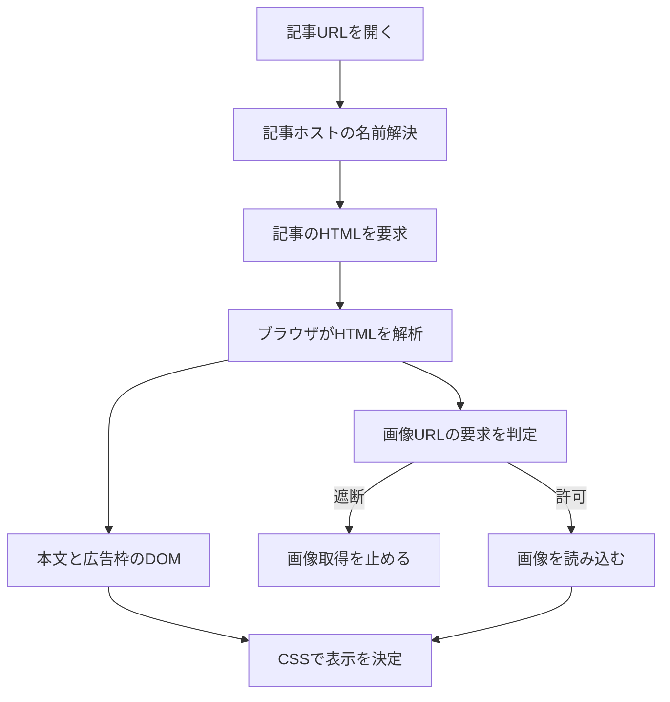
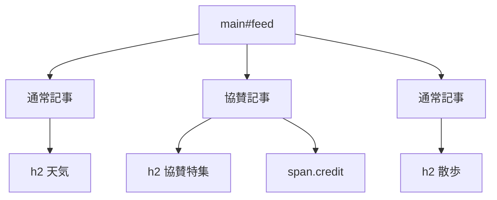
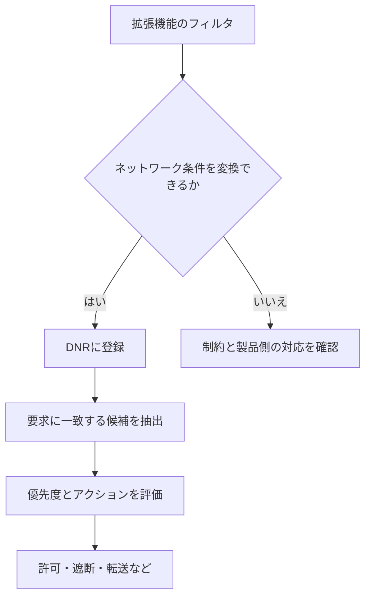
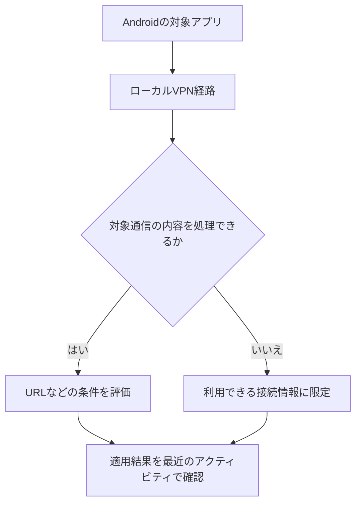
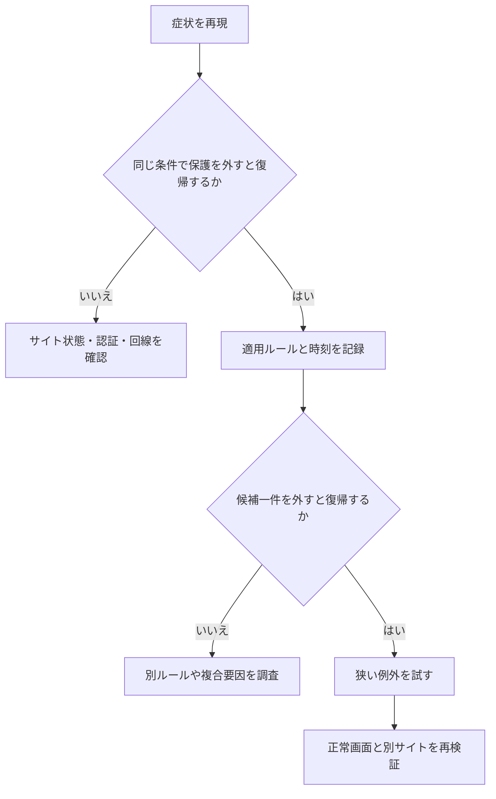

# AdGuard フィルタリングルール実践ガイド

AdGuardで広告や不要な要素をブロックするルールの書き方と、意図どおりに動くかを確かめる手順を、実例で解説します。

| Metadata | 情報 |
| --- | --- |
| **ホームページ** | [Red-Frame-X/Prototype](https://github.com/Red-Frame-X/Prototype) |
| **ライセンス** | CC0-1.0 |
| **Version** | 202611260023 |

## はじめに

記事を読みながら「この広告だけ消したい」と思ったとき、最初に何を選べばよいでしょうか。画像のURL、画像を囲む枠、「広告」と書いたラベルはそれぞれ別の対象です。本書では一つの記事ページを出発点にして、対象を決め、ルールを一行書き、消したくないものが残るところまで確かめます。

初めてルールを書く方は第1〜6章を順に読み、見覚えのある症状がある方は索引から該当箇所へ進んでください。コードブロックは個別の教材です。比較用の広い例外や互いを打ち消すルールもあるので、一冊分をまとめて購読する用途には向きません。

### 対象製品と読み方

主な対象はChromiumのAdGuard Browser Extension MV3とAdGuard for Androidです。公式Releasesで確認した参照版は拡張機能5.5.4、Android 4.16.1。更新される構文資料にはこれらより新しいVersionの説明も含まれるため、版条件がある箇所は製品名とともに示します。実機のインストール版との照合は行っていません。各章の通信例は架空の教材で、表の期待結果は個々のルールを評価する条件を示します。

構文を引くときは [付録A](#app-a) 、製品やVersionによる違いを調べるときは [付録B](#app-b) を参照してください。旧リファレンスから移した設計・検証の手順は、該当する章の実例と合わせて読めます。従来の記述と例は [AdGuard Custom Rulesの構文リファレンス](AdGuard%20Custom%20Rules%20Reference.md) で確認できます。

## 目次

- [第1章　広告ブロックとフィルタリングの基本原理](#ch-01)
- [第2章　ネットワークフィルタリングの基本構文](#ch-02)
- [第3章 Modifierの種類と適用条件](#ch-03)
- [第4章 例外ルールと適用範囲の制御](#ch-04)
- [第5章 HTML・DOM・CSSセレクタ](#ch-05)
- [第6章 Cosmetic Rules（要素非表示ルール）](#ch-06)
- [第7章 Extended CSS](#ch-07)
- [第8章 正規表現の活用](#ch-08)
- [第9章 ScriptletとRedirect Resources](#ch-09)
- [第10章 Cookie・トラッキング・迷惑要素への対処](#ch-10)
- [第11章 Chrome DevToolsを用いた解析](#ch-11)
- [第12章 Manifest V2・Manifest V3・Androidの仕様差](#ch-12)
- [第13章 誤ブロックの調査と修正](#ch-13)
- [第14章 フィルタの性能最適化と保守性](#ch-14)
- [第15章 AGLintによる品質管理](#ch-15)
- [第16章 実践的なフィルタ作成演習](#ch-16)
- [付録A フィルタリング構文一覧](#app-a)
- [付録B 製品別互換性表](#app-b)
- [付録C CSSセレクタ早見表](#app-c)
- [付録D 正規表現早見表](#app-d)
- [付録E Scriptlet・Redirect Resources一覧](#app-e)
- [付録F 実践的なユーザールール集](#app-f)
- [付録G AdGuardとuBlock Originの構文比較](#app-g)
- [付録H よくある質問](#app-h)
- [付録I 用語集](#app-i)
- [付録J 公式参考資料・参考文献](#app-j)
- [索引](#index)
- [あとがき](#afterword)
- [改訂履歴と検証記録](#revisions)

<a id="ch-01"></a>

## 第1章　広告ブロックとフィルタリングの基本原理

### 広告が消えたとき、何が変わったのか

ニュース記事を開くと、本文の途中に「広告」と書かれた枠があり、その中に画像が表示されたとします。画像が消えたあとに枠だけが残ったら、ルールは失敗でしょうか。答えは、何を止めようとしたかで変わります。この章では、一枚の画像を例に、通信の記録と画面の変化を別々に読めるようにします。

ブラウザが記事を取得すると、記事のHTMLには別のファイルを読み込む指示が含まれていることがあります。次の例では、段落と広告枠は記事の一部で、画像だけが外部のサーバーにあります。

```html
<article>
  <p>今日の地域ニュースです。</p>
  <aside class="sponsor"><span>広告</span>
    
  </aside>
</article>
```

記事のURLを `https://news.example.org/local/today?edition=morning` とします。`https` は通信方式、`news.example.org` はホスト名、`/local/today` はPath、`edition=morning` はQueryです。画像のホストは記事とは異なります。URLのどの部分に着目するかで、画像一枚を対象とするルールにも、画像サーバー全体を対象とするルールにもなります。

| 段階 | ブラウザの処理 | この例で観察するもの |
|---|---|---|
| 名前解決 | 接続に必要なホストのアドレスを調べる | media.example.net |
| HTTP Request | 対象リソースを要求する | /banner.png |
| HTTP Response | サーバーが要求に応答する | ステータスと画像データ |
| 描画 | 文書の構造とスタイルに従って表示する | 記事、広告ラベル、協賛画像 |

表は新規に通信する場合の概略です。キャッシュがある場合は、ページを表示するたびに全段階の通信が生じるとは限りません。

### 通信と表示を別々に調べる

```adblock
||media.example.net/banner.png$image,domain=news.example.org
```

このルールは、記事側のドメイン、画像リソースという分類、送信先のURLパターンを組み合わせます。対象画像の取得を止めても、HTMLに書かれた「広告」という文字は残り得ます。また、パターン末尾を固定していないため、同じ文字列の後ろにQueryが続いても対象になり得ます。

```adblock
news.example.org##aside.sponsor
```

こちらは記事内の広告枠を選び、ラベルと画像をまとめて非表示にするCosmetic Ruleです。画像のダウンロードを防げたかは、画面から判断できません。Filtering logで画像のURLを探し、処理結果と適用ルールを照合します。二つのルールを同時に追加すると、どちらの効果を見ているか判別しにくいため、演習では一行ずつ試します。

ChromiumのAdGuard Browser Extension MV3のストア配布版では、Filtering logに表示される適用ルールはエンジンによる推定です。画像の取得結果はDevToolsのNetworkで確認し、どのDNRルールが実際に適用されたかを特定する場合は、公式手順に従ってunpacked版で確認します。 [AdGuard公式のFiltering logの説明](https://adguard.com/kb/adguard-browser-extension/mv3-version/#main-changes-in-features-and-settings)

DNSではホスト名を扱います。同じホストの /banner.png と /weather.png を、Pathだけを根拠に区別することはできません。画像サーバーが記事の天気図も配信している場合、ホスト全体をDNSで止めると天気図にも影響します。

### 演習　「広告」の文字だけが残った

画像の通信にはブロックの記録があります。広告枠には見出し「広告」が残っています。この観察から、次にどの要素を調べますか。

**解答**　画像の親要素を調べます。上のHTMLでは aside が広告ラベルと画像をまとめています。article を選ぶと記事本文まで消えます。aside.sponsor が複数あれば、一致するすべての要素を確認してから適用します。

参考資料　[AdGuardのフィルタ構文](https://adguard.com/kb/general/ad-filtering/create-own-filters/) / [AdGuard DNSの構文](https://adguard-dns.io/kb/general/dns-filtering-syntax/)


### 図で追う　最初の記事と、その中の画像



ここで「枠だけ残る」のは、右側の画像取得を止めても、左側のDOMが記事自身のHTMLから作られるためです。DNSで画像ホストの名前解決を止める場合は、そのホストを使う他の画像にも影響します。DNSキャッシュや既存接続のある環境では、図の名前解決が毎回見えるとは限りません。

| 観察したいもの | 拡張機能 | Androidフル版 |
|---|---|---|
| どの通信が対象になったか | 拡張アイコンの右クリックなどからFiltering log | Statistics → Recent activity（統計情報 → 最近のアクティビティに相当） |
| ページ内の非表示ルール | Chromium・Firefoxの対応するログ表示を確認 | 同じルール別の表示があるとは仮定せず、DOMも比較 |
| 追加直後の変化 | 対象タブを再読み込み | 対象アプリ、HTTPS処理の有無、操作時刻も記録 |

[製品別のFiltering logの場所](https://adguard.com/kb/general/ad-filtering/create-own-filters/#filtering-log)

### OriginとSiteをアドレスで見比べる

https://news.example.org と https://img.example.org はホストが違うため別Originですが、同じスキームと登録可能ドメインを持ちます。https://news.example.org:8443 はポートが違うため元の記事と別Originです。登録可能ドメインを末尾二語で機械的に切り出すと、co.jp のような公開サフィックスを誤って一つのサイトと見なしてしまいます。ブラウザのCookie判断、Web標準の同一Origin判定、AdGuardのThird-party判定のどれを調べているかを明記してください。

### はじめて一行を追加するとき

Chrome系拡張ではAdGuardの設定からUser rulesを開き、Androidフル版では設定のFilteringからユーザールールの編集画面を開きます。既存の一覧を控え、教材の一行を改行で区切って追記します。保存・反映して対象ページを再読み込みし、Filtering logで処理したルールを開きます。再現時に戻せるよう、まず行頭に `!` を付けて無効化した状態とも比較してください。削除する場合は追加した一行を特定してから取り除きます。

予約済みドメインの架空のPathには、この本のHTMLが公開されているわけではありません。DOMの演習はHTMLをローカルに保存して試せます。ドメイン限定のネットワークルールを評価するには、同じホスト名・要求元・リソース種別を再現するTest環境が必要です。 [Androidの設定](https://adguard.com/kb/adguard-for-android/features/settings/) / [拡張機能の公式資料](https://adguard.com/kb/adguard-browser-extension/)


### どの順番で読み進めるか

まず、要素選択ツールが作ったルールを一行だけ読み、対象サイトとセレクタを見比べます。次に、画像の通信を止める場合と、残った枠を隠す場合を試します。すでに購読フィルタで処理される対象は、同じルールを手元に重ねる必要があるかログで確認してください。

基本の一行が読めるようになったら、公式フィルタの実例で条件の絞り方を学び、誤ブロックをログで切り分けます。最後に、使っている製品で変換や実行に制約があるかを確認します。 [第11章](#ch-11) 、 [第12章](#ch-12) 、 [第13章](#ch-13) で順に扱います。

<a id="ch-02"></a>

## 第2章　ネットワークフィルタリングの基本構文

### ホスト名に見える文字列を、どこで照合するか

`example.com` がURLに含まれることと、接続先が example.com であることは別の条件です。たとえば `https://news.example.org/help/example.com` の接続先は news.example.org です。次の表では各行を独立したルールとして扱います。許可・遮断の最終結果は他の有効なルールにも依存します。

| ルール | 対象になる例 | 対象から外れる例・条件 |
|---|---|---|
| `example.com` | 上のヘルプ記事にも文字列がある | example.org のトップにはない |
| `\|\|example.com^` | https://img.example.com/p.png | https://example.com.invalid/p.png |
| `\|\|example.com/ads/` | https://example.com/ads/a.png | https://example.com/news/ads/a.png |
| `\|https://example.com/ads/banner.js\|` | 指定したURL | 末尾に ?v=2 を付けたURL |
| `\|\|example.com^$third-party` | example.org の記事が example.com の画像を要求 | example.com の記事が同じホストの画像を要求 |
| `@@\|\|example.com^` | example.com の画像への通常の遮断に対する例外 | example.net の画像への遮断 |

先頭の縦線二本はホスト名の境界に着目し、末尾の山形記号は区切り文字またはURL末尾を表します。ピリオドはこの区切り文字に含まれません。一方、縦線一本はパターンの先頭ならURLの先頭、末尾ならURLの末尾を固定します。URL全体を固定すると意図を読みやすい反面、配信側がQueryを追加しただけでも一致しなくなります。

### 一行を読める単位に分ける

```adblock
! 記事サイトで読み込む協賛画像を対象にする
||media.example.net/campaign/*/hero.png$image,domain=news.example.org
```

一行目はコメントです。二行目ではアスタリスクがゼロ文字以上の任意の文字列に一致するため、campaign/spring/hero.png と campaign/autumn/hero.png を同じパターンで扱えます。スラッシュをまたぐ文字列にも一致するので、「ディレクトリ一階層」という意味には限定できません。ドル記号から右はModifierです。ここでは画像であることと、要求元のドメイン条件の両方を確かめます。`~` は使う場所で意味が決まり、たとえば `$~image` は画像以外を対象にします。URLパターンの文字を否定する記号としては使えません。

**演習**　画像の拡張子に続けて .backup が付いたURLも対象になるでしょうか。

**解答**　URLパターンは hero.png で終端を固定していないので、その後ろに .backup があってもパターン部分は一致します。ただし、実際の要求が画像に分類され、要求元の条件も満たす必要があります。拡張子だけではリソースの分類は決まりません。

参考資料　[AdGuardのBasic rules](https://adguard.com/kb/general/ad-filtering/create-own-filters/#basic-rules)


### 同じ文字に見えるURLをログと照合する

日本語のPathやスペースは、画面に見える表記と、要求URLのパーセントエンコード表記が違うことがあります。DevToolsのRequest URLとFiltering logを見比べ、どの文字列に一致させるかを確定します。たとえば `a%2Fb` の %2F を機械的にスラッシュへ展開すると、一つのPath成分と二つの階層を混同し得ます。Basic Rulesは通常、英字の大文字と小文字を区別しません。サーバーが /Ads/ と /ads/ を区別する場合は `$match-case` を検討し、両方を反例に入れます。

`||` はネットワークルールのホスト境界を示しますが、Cosmetic Ruleの左側には書きません。複数のTLDを表す `example.*` は、Cosmetic Rulesなどのドメイン指定やBasic Rulesの `$domain` に固有の扱いがあります。URLパターン中の一般的なアスタリスクとは別の機能です。国別サイトの見かけが同じでも全ドメインでの動作が同じとは限りません。


<a id="ch-03"></a>

## 第3章 Modifierの種類と適用条件

### 画像を配信しているのは誰か

記事を開くと広告画像が一枚表示されました。Filtering logで得た情報を、一度日本語の文章にしてみましょう。「news.example.org の記事が、media.example.net の /campaign/ から画像を読み込んだ」。ここには要求元、送信先、Path、リソースの種類という四つの条件があります。

```adblock
||media.example.net/campaign/$image,domain=news.example.org
```

まずURLパターンで送信先とPathを絞ります。次の `image` はブラウザまたは製品が認識したリソース種別、`domain` は適用元の条件です。拡張子が .png でも JavaScript が fetch で取得する場合には同じ種別とは限りません。

| 変更する条件 | 例 | この一行の期待結果 |
|---|---|---|
| 基準 | 指定の記事が /campaign/a を画像として要求 | 遮断 |
| 種別だけ | 同じURLをデータとしてfetch | 画像条件から外れる |
| 要求元だけ | shop.example.org から同じ画像を要求 | ドメイン条件から外れる |
| Pathだけ | 記事が /weather/map.png を要求 | URL条件から外れる |

### ANDとORを読み分ける

`$image,media,third-party` の種別部分は「画像または音声・動画」、その集合に対して「かつThird-party」です。すべてのカンマを機械的にANDと読むと、一度の要求に画像と動画の両方を要求するという不自然な解釈になります。`$domain=news.example.org|shop.example.org` は要求元の候補を並べます。`~` を値の先頭に置く除外と、Modifier名の前に置く否定は文法上別です。各Modifierで使える記法は付録Aの仕様節で調べます。

### 「同じサイト」の境界を試す

news.example.org から img.example.org へ画像を要求すると、ホスト名は異なります。通常のThird-party条件ではこの組み合わせは同一登録可能ドメイン側です。一方、strict系はホスト名を厳密に比べるので結果が変わります。ポートやスキームを含むOriginの比較とも区別しましょう。適用元を特定できない要求の扱いにはエンジンの版による差があります。

**練習**　閲覧元が一定で送信先が複数あるとき、送信先を列挙する候補は何でしょう。**解答**　`$to` です。要求元の `$domain` と取り違えると、写し間違いのないドメイン名でも期待した通信に一致しません。設定後は別サイトから同じ送信先へアクセスする反例も記録します。

### 実習　同じURLで種別だけを変える

一枚の画像に見えるファイルを、文章の中のimg要素が読む場合と、JavaScriptがfetchでバイト列を取得する場合を考えます。書き手が見ているファイル名は同じでも、ブラウザが伝える要求の種類が違えば `$image` の結果も変わります。次の手順は、実際に紙に書いた期待値をエンジン単体で確認する例です。Node.jsの作業用フォルダに `npm install --save-exact @adguard/tsurlfilter@6.1.0` で依存関係を追加し、次を network-check.mjs として保存します。

```js
import assert from 'node:assert/strict';
import { Engine, Request, RequestType, setConfiguration } from '@adguard/tsurlfilter';

setConfiguration({ engine: 'extension', version: '1.0.0', verbose: false });
const engine = Engine.createSync({
  filters: [{ id: 1, content: '||media.example.net/campaign/$image,domain=news.example.org' }],
});
const page = 'https://news.example.org/local/today';
const target = 'https://media.example.net/campaign/a';
function isBlocked(url, source, type) {
  const hit = engine.matchRequest(new Request(url, source, type)).getBasicResult();
  return hit !== null && hit !== undefined && !hit.isAllowlist();
}
assert.equal(isBlocked(target, page, RequestType.Image), true);
assert.equal(isBlocked(target, page, RequestType.XmlHttpRequest), false);
assert.equal(isBlocked(target, 'https://shop.example.org/', RequestType.Image), false);
assert.equal(isBlocked('https://media.example.net/weather/a', page, RequestType.Image), false);
```

`node network-check.mjs` が正常に終了すれば四つの期待値が成立しています。ここで version はエンジン設定の入力例です。インストールしたライブラリのVersionはpackage-lock.jsonに記録されます。TestではURL・要求元・種別をこちらから与えているため、実際のアプリがどの種別と判定するか、またMV3で登録されたかは別途観察します。

### 条件を組み立てるための小辞典

| 設定したい条件 | 記述例 | 具体的な反例・制約 |
|---|---|---|
| 要求元を二つに限定 | `$domain=news.example.org\|shop.example.org` | 同じ宛先へ別サイトから送ると一致しない |
| 要求元の一部を除外 | `$domain=example.org\|~pay.example.org` | 決済サブドメインからの要求を除く |
| 宛先を限定 | `$to=media.example.net` | news.example.orgが送信先になる場合は条件外 |
| 取得メソッドを限定 | `$method=get\|head` | POSTは条件外。値は小文字で記述 |
| アプリで限定 | `$app=org.example.reader` | 同じ端末のブラウザにも適用したい場合は対象外になる |
| 通常の同一サイト要求 | `$~third-party` | サブドメイン間でも対象になり得る |
| ホスト名の厳密な一致 | `$strict-first-party` | 別サブドメインからの要求は同じ扱いにならない |
| パスの大小文字を区別 | `$match-case` | /Ads/ と /ads/ が同じ結果になるという仮定を外す |
| 応答ヘッダーがある場合 | `$header=x-demo-banner` | そのヘッダーがない応答は一致しない |
| 記録した遮断理由を表示 | `$document,reason="Demo"` | 画像リソース向けの汎用コメントとしては使えない |

### 応答に手を加える前に読むもの

あるページがJSONで記事と協賛カードを一緒に返すなら、そのURLを遮断すると記事も届きません。候補は、①通常の記事を残して協賛カードを非表示、②対応環境でJSONの対象フィールドだけを処理、の二つです。後者は、表示前のデータを変えるため、件数、ページ送り、欠落フィールドを読むJavaScriptへの影響も確認します。受信したデータを変える機能が製品になければ、別の層で同じ効果を実現できるか検討します。

| 受信物 | 関連するModifier | 修正前に保存する対照 |
|---|---|---|
| JSON | `$jsonprune` | 通常記事、空の配列、必須キーがない場合 |
| XML | `$xmlprune` | 同名要素が異なる親にある例 |
| HLSプレイリスト | `$hls` | 本編開始、シーク、次の断片への移行 |
| テキスト応答 | `$replace` | 置換対象のない応答、複数箇所での一致 |
| Cookieヘッダー | `$cookie` | ログイン前後、再読込、カートの維持 |
| レスポンスのポリシー | `$csp`、`$permissions` | 元のヘッダー、ページが必要とする機能 |

### ページ例外が効く範囲

`$generichide` は広い範囲に配布された非表示ルール、`$specifichide` は特定サイト向けの非表示ルールに着目します。両方の種類を解除する `$elemhide` まで広げる前に、問題の要素を隠しているルール自身に対応する `#@#` で足りるかを確認しましょう。`$genericblock`・`$urlblock` は通信側の例外、`$jsinject` はScript注入関連、`$content` はHTMLなどの応答処理関連です。ページの症状が見た目に現れていても、必要な例外が表示側とは限りません。

**応用問題**　`$image,media` を `$~script` にまとめてよいでしょうか。**解答**　後者には画像・動画以外の非Script要求も入るため、同等ではありません。フォント要求を一件加えるだけで違いを確認できます。

参考資料　[条件・種別・処理の仕様](https://adguard.com/kb/general/ad-filtering/create-own-filters/#basic-rule-modifiers) / [TSUrlFilterの使い方](https://github.com/AdguardTeam/tsurlfilter)

### 埋め込み枠と記事ページを見分ける

記事内に広告用の iframe と決済用の iframe があるとします。広告用の枠だけを止めるなら、ログで埋め込み文書のURLと種別を確認してから、Pathまで含むパターンに `$subdocument` を付けます。たとえば次の教材では、広告枠に一致し、決済枠と記事本体が読み込まれることを確かめます。

```adblock
||embed.example.net/ad-frame.html^$subdocument,domain=news.example.org
```

ページそのものを扱う `$document` と、埋め込まれた文書を扱う `$subdocument` の違いは、例外を作るときにも効いてきます。

通知や共同編集が止まったときは `$websocket`、計測用ビーコンが残ったときは `$ping` が調査の手がかりになります。Fetchで送る計測データや動画プレーヤーのAPIなど、見た目だけでは種別が分からない通信もあります。実際の種別をログで確かめ、必要な場合だけ `$method` でメソッドを絞ります。 [付録AのModifier辞典](#app-a)

<a id="ch-04"></a>

## 第4章 例外ルールと適用範囲の制御

### ログイン用の画像だけを戻す

あるフィルタが assets.example.net を遮断し、記事サイトのログイン画面で確認画像が欠けました。次の候補を一度に登録するのでなく、どの通信まで許可されるかを比較してください。

```adblock
@@||assets.example.net^
@@||assets.example.net^$third-party
@@||assets.example.net^$domain=news.example.org
@@||assets.example.net^$domain=assets.example.net
@@||assets.example.net^$document
@@|https://assets.example.net/login/check.png|$image,domain=news.example.org
```

| 行 | 判断材料 | 見落としやすい影響 |
|---|---|---|
| 1 | 宛先ホストとそのサブドメイン | 他サイトが読み込んだ解析用画像にも届く |
| 2 | 上記に加えてThird-party | 許可する第三者サイトを一つに限定していない |
| 3 | 記事サイト側のドメイン | 同じ記事からの別Pathも該当する |
| 4 | 配信元自身側のドメイン | 記事サイトからの埋め込みを救済する例外にはならない |
| 5 | 対象ドキュメントへの例外 | ページ単位の広い除外。画像一枚の障害には過大 |
| 6 | URL、画像種別、要求元 | Queryが追加されれば一致しなくなる |

通常の遮断と通常の許可が競合すれば例外が優先されます。`$important` を付けた遮断には通常の例外だけで勝てません。まず適用されたルールを読んでください。`$badfilter` は同じ対象ルールを無効化する手段です。元のルールが全サイト向けなら無効化の影響も全サイトに及び得ます。

### 表示だけを戻す

```adblock
news.example.org##.sponsor
news.example.org#@#.sponsor
```

後者は対応する非表示ルールを打ち消します。別の親要素を隠すルール、サイト自身のCSS、画像通信の遮断が残っていれば表示は復帰しません。Scriptletにも対応する例外記号があり、名前と引数を元のルールと照合します。

**練習**　最後のネットワーク例外で画像が復帰しました。例外が広すぎないことをどう調べますか。**解答**　記事上の別画像、別サイトに埋めた同じ画像、同じPathにQueryを付けた要求を試し、許可された記録と比較します。

### ケーススタディ　同じ宛先を「サイト」と「配信元」の両方に使う

`links.example.net` を直接開く場合、記事の中から画像として呼ぶ場合、そのホスト上のページが自分の素材を取得する場合を分けます。同じ文字列がアドレス欄にあっても、要求元を限定した例外で救済できる段階とは限りません。特にリンクのクリックでは、最初の文書、リダイレクト応答、最終文書を別の記録として追います。

| 記録 | 要求元の観測 | 送信先 | 読み取り方 |
|---|---|---|---|
| A | news.example.org の記事 | links.example.net の画像 | links側自身を要求元とする条件には通常合わない |
| B | links.example.net の文書 | 同じホストのCSS | 宛先と要求元の両方がlinks側 |
| C | アドレス欄から直接入力 | links.example.net の主文書 | 発生元情報がない場合を含む。Bから結果を推定しない |
| D | Bを表示した後の別サイトへの遷移 | shop.example.org | 宛先が異なるのでlinks用のホストパターンから外れる |

### 優先順位を切り分ける四つの試行

```adblock
||ads.example.net^
@@||ads.example.net/banner.png$image,domain=news.example.org
```

この二行なら通常の許可に該当する画像と、同じホストの別画像を比較できます。次に遮断側に important を付けた状態を独立した試行として評価し、通常例外で回復しなくなる条件を確認します。三つ目の試行では元の通常遮断に戻し、その一行に対する badfilter を試します。四つ目は他フィルタの別パターンにも一致する画像です。元の一行を無効にしても、別ルールの遮断は残り得ます。

```adblock
||ads.example.net^$badfilter
```

この一行を第2のサイトの分だけ無効にする例だと読むと、例外を広げ過ぎます。判断結果を記録するときは「画面が直った」と「どの遮断が残った」を別列にしてください。

参考資料　[例外と優先順位](https://adguard.com/kb/general/ad-filtering/create-own-filters/#rule-priorities)

<a id="ch-05"></a>

## 第5章 HTML・DOM・CSSセレクタ

HTMLは文書の記述、Document Object Model（DOM）はブラウザが組み立てた要素とその関係です。記事の一覧に協賛記事が一件だけ混じる場合を考えましょう。

```html
<main id="feed">
  <article class="card"><h2>明日の天気</h2></article>
  <article class="card" data-kind="sponsor"><h2>協賛特集</h2>
    <span class="credit">広告</span></article>
  <article class="card"><h2>週末の散歩</h2></article>
</main>
```

| DOMの親 | 直接の子 | 選択したときの範囲 |
|---|---|---|
| main#feed | 3個のarticle | 一覧全体 |
| 2番目のarticle | h2 と span.credit | 協賛カード全体 |
| span.credit | 「広告」のテキスト | ラベルだけ |

`.card` は3件、`[data-kind="sponsor"]` は1件、`article > .credit` はラベル1個を選びます。`article:has(> .credit)` はラベルを直接持つ記事に戻って1件を選びます。タグ名にピリオドが続く `article.card` は両条件を満たす一つの要素、空白のある `article .card` は記事の中にある別の要素です。

隣接する次の兄弟を示す `+` を使えば `article[data-kind] + article` は「週末の散歩」に一致します。`~` なら後続の該当兄弟すべてです。文書の並びが変わると一致先も変わります。属性の部分一致は便利ですが、クラス属性全体の先頭を調べる `[class^="ad-"]` はクラスの並び順に左右されます。

CSSの詳細度は競合するスタイルの決定に関わります。一致件数を絞る尺度ではありません。擬似要素 `::before` によるラベルには独立したDOM要素がありません。iframeには別の文書があり、Shadow DOMにも境界があります。Elementsで見えた親子のような並びを、一つの通常セレクタでそのまま横断できるとは限りません。

**練習**　カードの順序を入れ替えても協賛記事を特定できる候補は何でしょう。**解答**　このHTMLなら `article[data-kind="sponsor"]` です。実際のページでは通常記事、検索結果、追加読み込み後にも同じ属性の意味が保たれるか調べます。

### 画面では隣に見えても、DOMでは兄弟とは限らない



広告ラベルLに一致するセレクタを作った時点では、記事B全体を選べていません。Elementsのハイライトに見出しが含まれるか確かめると、一段上へ進む必要があるか分かります。CSSのGridやFlexboxで視覚的な順番が入れ替わっても、隣接兄弟の基準はDOM上の順序です。画面幅を変えたときに突然違うカードが隠れる場合、モバイル用とデスクトップ用に別のDOMが存在しないかも確認します。

参考資料　[Selectors Level 4](https://www.w3.org/TR/selectors-4/)

<a id="ch-06"></a>

## 第6章 Cosmetic Rules（要素非表示ルール）

### どこを隠せば空白まで消えるか

第5章のラベルだけを隠すと、タイトルとカードの余白は画面に残ります。協賛記事一枚を非表示にしたいなら、カードを囲むarticleを選びます。

```adblock
news.example.org##article[data-kind="sponsor"]
```

`##` の左は適用する文書のドメイン、右は要素を選ぶ条件です。左を省いたGeneric Ruleは他のサイトにも届きます。異なるサイトが同じ属性を別の意味で使うことは珍しくありません。複数サイトへの適用や除外を表記できても、確認できた範囲から始めた方が原因を追いやすくなります。

| 手段 | 画面 | DOMまたは通信に残るもの |
|---|---|---|
| 通信遮断 | 画像が欠ける場合がある | 枠や見出しは残り得る |
| 要素非表示 | 一致する枠が見えなくなる | 要素やリソース要求は残り得る |
| CSS injection | 指定したスタイルが変わる | 要素は残る |
| DOMから削除 | 対象ノードが外れる | 既に開始した要求やサイトの内部状態 |
| HTML filtering | 対応環境で文書内容を処理 | ブラウザで後から生成されるノードは別途確認 |

固定フッターを消してもスクロールできない場合は、Elementsでbodyやルート要素のcomputed styleを見ます。モーダル表示中にサイトがスクロールを固定しているかもしれません。常時bodyのoverflowを上書きすると、ログインダイアログの背後まで動く副作用が出ます。影響する状態を限定できるまでは恒久ルールにしません。

**練習**　通常記事を残したまま表示を復帰する例外を書いてください。**解答**　上のルールに対応する例外は次です。対象が親要素の別ルールでも隠れていればそちらの調査も必要です。

```adblock
news.example.org#@#article[data-kind="sponsor"]
```

参考資料　[AdGuardのCosmetic Rules](https://adguard.com/kb/general/ad-filtering/create-own-filters/#cosmetic-rules)

### 枠の表示だけを変えるか、要素を取り除くか

広告枠を非表示にしたあと本文がスクロールできない場合は、開発者ツールでスクロールを止めている要素とプロパティを確認します。スタイルの調整が必要なら、通常のセレクタを使う `#$#` と、Extended CSSで選んだ要素に宣言を適用する `#$?#` を使い分けます。 [付録Aのフィルタリング構文一覧](#app-a)

DOMから要素を取り除く `:remove()` を試す場合は、同じページで更新される動画や操作ボタンも確認します。表示だけを変える場合と比べて、サイトのScriptが参照する要素自体が失われるためです。 [付録CのCSSセレクタ早見表](#app-c)

<a id="ch-07"></a>

## 第7章 Extended CSS

### 同じ構造で違いがラベルの文字だけの場合

すべてのカードが同じclassを持ち、協賛カードに限ってラベルの文字が「協賛」とします。普通のCSSは要素のテキスト内容そのものを条件に選べません。Extended CSSはテキスト、計算済みスタイル、要素のプロパティなどを追加の手掛かりにできます。

```adblock
news.example.org#?#article.card:has(> .label:contains(/^協賛$/))
```

`#?#` はExtended CSSでの要素選択を明示します。最初に候補をarticle.cardに限定し、直下のラベルを評価します。正規表現の両端を固定したので「協賛について」には一致しません。ラベルに余白や改行が含まれる実装なら取り逃し得ます。ルールを広げる前にElementsで実際の文字列を確認します。

| 選択手段 | 調べるもの | 壊れやすい場面 |
|---|---|---|
| `:contains()`、別名 `:has-text()` | 対象のテキスト | 翻訳、表記変更、親に含まれる子の文字 |
| `:matches-css()` | computed style | テーマ、画面幅、ブラウザ正規化 |
| `:matches-attr()` | 属性名・値のパターン | 同じ属性を通常カードでも使う |
| `:matches-property()` | DOMオブジェクトのプロパティ | フレームワーク内部の変更 |
| `:upward()` | 祖先の段数または条件 | ラッパー要素の追加 |
| `:xpath()` | 指定したXPath | 深い位置指定、広い探索範囲 |
| `:remove()` | 選択後のDOM削除 | 再挿入、イベントや参照への影響 |

標準の `:has()` が使えて安定した子属性もある場合は、前章の通常ルールで目的を達成できます。ただしテキスト条件を子要素の存在だけに置き換えると、通常記事のラベルも選び得ます。SPAで記事を追加した後も、選んだ件数と残した記事を記録します。

**練習**　見出しが「協賛募集」の通常記事が消えました。**解答**　カード全体に部分一致をかけていないか調べます。ラベルへ探索範囲を限定し、見出しだけの通常記事を反例に残します。 [ExtendedCssの構文とAlias](https://github.com/AdguardTeam/ExtendedCss)

### 実験ノート　セレクタを置き換えてよい条件

ページの実装が変わり、協賛ラベルに data-role="ad-label" が追加されたとします。通常CSSへ移行する前に次のケースを表にして、旧候補と新候補が選ぶarticleを比較します。

| カードの状態 | テキスト条件 | 属性条件 |
|---|---|---|
| 「協賛」で属性あり | 一致 | 一致 |
| 翻訳されて「Sponsored」で属性あり | 不一致 | 一致 |
| プレビュー表示で「協賛」だが属性なし | 一致 | 不一致 |
| 表示されないテンプレート内にラベルあり | 実際のDOMを検査 | 実際のDOMを検査 |

二行目の変化は望ましいかもしれませんが、同一動作の最適化とは区別して変更履歴に残します。ExtendedCssの旧記法には互換用の形式があり、`:if-not()` のように現在のライブラリで無効とされるものもあります。古いブログ記事のセレクタは対象Versionの構文一覧と照合します。

### ラベルがテキストノードに見つからないとき

「広告」の文字が `::before` や `::after` の `content` で描かれていれば、開発者ツールの計算済みスタイルを確認します。 `:matches-css-before()` と `:matches-css-after()` は、その値を条件にできます。 `:matches-css()` は要素自身の計算済みスタイル、 `:matches-attr()` は属性名や属性値を調べる場合の候補です。

同じ記事一覧で、まずカードやその親要素まで候補を絞り、広告ラベル付きの記事と通常記事を一つずつ見比べます。たとえばカードの `::before` に「広告」が入る教材なら、次のように条件を組み立てます。

```adblock
news.example.org#?#.article-card:matches-css-before(content: *広告*)
```

広告ラベルが子要素に入っているときは `:has()`、見つけたラベルから外枠へさかのぼるときは `:upward()` も候補です。 [AdGuard公式構文リファレンスのExtended CSS](https://adguard.com/kb/general/ad-filtering/create-own-filters/#extended-css-selectors)

<a id="ch-08"></a>

## 第8章 正規表現の活用

### 号数だけが変わる画像を選ぶ

`/promo/issue-12.png` と `/promo/issue-408.png` は対象、`/promo/issue-final.png` は対象外です。単純なワイルドカードは final も許してしまいます。数字の位置だけを文字クラスで指定します。

```adblock
/^https:\/\/media\.example\.net\/promo\/issue-[0-9]+\.png(\?|$)/$image
```

外側のスラッシュが正規表現の境界、先頭の `^` が文字列の先頭、`[0-9]+` が1文字以上の数字です。ドットをエスケープし忘れると任意の一文字になります。末尾の選択はQueryかURL末尾を許します。余分なPathが続く .png.backup は対象外です。Basic Ruleの区切り文字 `^` と、正規表現の `^` は位置も意味も異なります。

| 入力の末尾 | 期待 | 理由 |
|---|---|---|
| issue-0.png | 一致 | 0も数字 |
| issue-02.png?v=3 | 一致 | 先頭ゼロとQueryを許す設計 |
| issue-.png | 不一致 | 数字がない |
| issue-3Xpng | 不一致 | ドットがリテラル |
| issue-3.png/extra | 不一致 | 許した境界がない |

`(a|b)` は選択した部分をキャプチャし、`(?:a|b)` は値を取り出さずにまとめます。貪欲な `.*` は広く取り、最短の `.*?` は後続条件が成立する最短の位置を探します。いずれも区切りを越え得るので「スラッシュまで」なら `[^/]+` が読みやすくなります。長い入力に対する入れ子の量指定は過度なバックトラッキングの原因になり得ます。

ChromeのDNRはRE2系の制約を持ちます。JavaScriptで成立する先読み・後読みや後方参照をそのまま持ち込めません。Chrome APIの `isRegexSupported()` は対象ブラウザで式を検査する手段です。JavaScriptのTest通過、DNRへの変換成功、実際の要求への適用は別々に記録します。

**練習**　issue- の後ろをちょうど2桁に限定してください。**解答**　`[0-9]{2}` に変更します。issue-0.png と issue-408.png が対象から外れるため、これは適用範囲の変更です。

参考資料　[AdGuardの正規表現](https://adguard.com/kb/general/ad-filtering/create-own-filters/#regexp-support) / [DNRのregexFilter](https://developer.chrome.com/docs/extensions/reference/api/declarativeNetRequest)

<a id="ch-09"></a>

## 第9章 ScriptletとRedirect Resources

### 「何が実行されるか」と「何が返るか」

Scriptletは、製品に用意された小さなJavaScript処理を名前で選び、引数を与える仕組みです。Redirect Resourceは通信に対して代替の内容を返します。両方で広告が消えても、調べる場所が違います。

| 順序 | Scriptletで表示フラグを扱う例 | RedirectでScriptを置き換える例 |
|---|---|---|
| 1 | 対象文書のドメインを判定 | Scriptを要求したURLと種別を判定 |
| 2 | 製品が対応する処理に引数を渡す | 適合する代替Resourceを選ぶ |
| 3 | ページのコードがプロパティを読む | ページが代替内容を受け取る |
| 4 | 表示分岐を観察 | 読み込み後の処理とエラーを観察 |

教材ページのコードが `window.demoSponsorEnabled === true` のときだけ協賛カードを描くとします。プロパティ名と値の型を調べてから、次の候補を試します。

```adblock
news.example.org#%#//scriptlet('set-constant', 'demoSponsorEnabled', 'false')
```

引数は引用符で囲みますが、Scriptletが許容する定義済みの値として解釈します。実行時期が遅く、ページが既に値を別変数に保存していたら、読み取り済みの結果は戻りません。適用をやめる対応例外は次のとおりです。

```adblock
news.example.org#@%#//scriptlet('set-constant', 'demoSponsorEnabled', 'false')
```

一方、特定のScriptを空のJavaScriptに差し替える候補は次です。元Scriptが広告描画のほかにメニュー用APIも定義していたら、差し替えでメニューが壊れます。

```adblock
||media.example.net/demo/sponsor.js$script,redirect=noopjs,domain=news.example.org
```

`$redirect` は遮断と代替を一つのルールで指定します。`$redirect-rule` は別のルールで遮断されることを前提に置換条件を加えます。後者はChromium MV3版で非対応です。JSONを期待する呼び出しに空のScriptを返した場合、通信上のエラーが消えてもJSONの解析に失敗します。形式と呼び出し側の契約を確認してください。

任意のJavaScriptを記述するルールやUserScriptには別の権限・配布条件があります。公式資料はユーザールールをTrusted filtersに含めていますが、製品が実装しない機能まで有効になるわけではありません。特にMV3では製品に同梱された機能、呼び出せるScriptletとその引数の制限を確認します。

**練習**　画像URLを変えずにダウンロードも防ぎたいとき、表示フラグを変えただけで成功と言えるでしょうか。**解答**　Networkで要求を観察します。ページが画像を先読みしていれば、描画分岐を止めても要求は残ります。

参考資料　[Scriptletの名称と引数](https://github.com/AdguardTeam/Scriptlets/blob/420ffa66c6e713ffa95c80e4bfa356b1a796c3a3/wiki/about-scriptlets.md) / [置換リソース](https://github.com/AdguardTeam/Scriptlets/blob/420ffa66c6e713ffa95c80e4bfa356b1a796c3a3/wiki/about-redirects.md)

### 応答が届くかどうかも確かめる

計測用のScriptを止めるとページが読み込み中のままになる場合は、統計用の処理が止まったかに加えて、ページがScriptの応答を待ち続けていないかを調べます。 `$redirect` は一致した通信を指定のリソースに置き換えます。 `$redirect-rule` は別のルールでブロックされる通信に置換先を指定する構文で、AdGuard Browser Extension MV3では使えません。旧ルールの `$empty` は非推奨で、公式リファレンスでは `$redirect=nooptext` として扱われます。 [AdGuard公式構文リファレンス](https://adguard.com/kb/general/ad-filtering/create-own-filters/)

応答のJSONから項目を外すなら、ページ側でJSONを処理する `json-prune` と、通信経路上で本文を書き換える `$replace` では介入する場所が異なります。FetchとXHRでは対応するScriptletも異なります。ログに残る通信と画面上の結果を両方確認し、注入だけを取り消す場合は元のルールに対応する `#@%#` の例外を確認します。 [付録EのScriptlet・Redirect Resources一覧](#app-e)

<a id="ch-10"></a>

## 第10章 Cookie・トラッキング・迷惑要素への対処

### 同意バナーの三つの状態

初回訪問時にバナーが出る、拒否ボタンを押すと閉じる、再訪問時に選択が記憶される。この三つを分けて観察します。Cosmetic Ruleが直接扱うのは画面上の要素です。バナーを隠しても「拒否」という値が記録された証拠にはなりません。

| 調べたいこと | 観察箇所 | 比較する状態 |
|---|---|---|
| 何が画面を覆うか | Elementsのバナー、背景、body | 開く前・表示中・閉じた後 |
| 選択を覚えたか | ApplicationのCookieとWeb Storage | 操作前・拒否後・再読み込み後 |
| 外部通信が変わったか | NetworkとFiltering log | 同じページ操作・同じ観察時間 |

Cookieは条件に応じてHTTP要求と共に送られます。Local Storageの値は同じ仕組みで自動送信されませんが、ページのScriptが読み取って通信に含めることはできます。Session Storageの寿命や共有範囲はLocal Storageと違います。Cookieが増えないことだけで追跡全体の有無を判断できません。Fingerprintingではブラウザの特徴が利用される場合があります。

### URLから計測用パラメータを一つ取り除く

```adblock
||shop.example.org/catalog/$removeparam=demo_campaign
```

商品URLが `/catalog/item?id=42&demo_campaign=summer` なら、残したいのは商品を選ぶ id=42 です。削除対象のないURL、同名の値が別の意味を持つ画面、署名付きURLも別々に比較します。署名の計算にQueryが含まれるサービスでは変更が認証失敗につながり得ます。広告計測、購入紹介の帰属、ログイン遷移はURLを介していても目的が違います。

ニュースレターのオーバーレイは特定要素の非表示で足りるかもしれません。自動再生は映像通信を全面遮断すると、読者が再生したい本編まで壊れます。通知要求はサイト内の予告バナーとブラウザ自身の権限ダイアログを区別します。追跡Pixelは目に見えなくても要求されるので、通信を止める目的ならNetworkで判定します。

**練習**　「バナーが消えてページがスクロールできる」を同意処理の合格条件にしてよいでしょうか。**解答**　表示上の条件として記録し、拒否の保存と外部要求の変化には別の合格条件を設けます。

参考資料　[Cookie処理](https://adguard.com/kb/general/ad-filtering/create-own-filters/#cookie-modifier) / [Queryの処理](https://adguard.com/kb/general/ad-filtering/create-own-filters/#removeparam-modifier)

### 通信を止めずに変更したいとき

商品ページへの遷移を残したいなら、まず何を変更するのかを決めます。Queryから名前で項目を取り除くなら `$removeparam`、URLの一部を置き換える必要があるなら `$urltransform` を調べます。元のURLと変更後のURLを記録し、商品IDや署名付きURLなど、残すべき値を含む例も試します。

応答ヘッダーの名前や値で通信を選ぶ `$header` と、指定のヘッダーを取り除く `$removeheader` も用途が異なります。Cookieを扱う `$cookie` では、計測の有無に加えてログインや同意の状態が残るかを確認します。製品によって書き換えの対応範囲が異なるため、記法を選んだら互換性表と各Modifierの公式説明を確認します。 [付録A](#app-a) / [付録B](#app-b)

<a id="ch-11"></a>

## 第11章 Chrome DevToolsを用いた解析

### 記事に追加される二枚目のカードを調べる

1. ChromeOSのChromeで対象タブを開き、メニューからデベロッパー ツールを開きます。キーボードなら通常は Ctrl+Shift+I です。開き方やウィンドウ配置は端末と管理設定に依存します。
2. Networkを開いた状態で再読み込みします。リダイレクトをまたぐ調査ではPreserve logを有効にし、キャッシュの影響を調べる試行ではDisable cacheの状態も記録します。
3. カードが追加される操作を一回行います。要求のURL、Type、Initiator、時刻を記録します。Headersで要求と応答を分けて読みます。200というステータスは、返った内容がページの期待どおりだった証明にはなりません。
4. Elementsの要素選択でカードの枠を選び、親と兄弟を順にハイライトします。通常記事を巻き込まない位置に戻ってセレクタを作ります。
5. Consoleの実行対象フレームを確認して、候補の件数と各要素の見出しを読みます。ページ自体を書き換える必要はありません。

```js
Array.from(document.querySelectorAll('article[data-kind="sponsor"]'),
  card => card.querySelector('h2')?.textContent?.trim())
```

6. AdGuardのFiltering logを開き、同じ操作を繰り返します。Networkの要求とログをURL・時刻・発生元で照合します。Chromium MV3のストア配布版では、ログに示されたルールを候補として扱います。競合する候補から実際に適用されたルールを特定するときはunpacked版を使います。ルールを一行追加し、協賛カード、通常記事、次ページへの移動を再確認します。

### 結果が揃わない場合

Service Workerから応答が返る場合、キャッシュ無効化だけで同じ通信経路を再現できるとは限りません。ApplicationでService Workerの有無を確認します。iframe内ならその文書のドメインと実行コンテキストを記録します。ログに複数の拡張機能が関与し得る環境では、同じ結果を単独構成でも再現できるかを比較します。

Android版Chromeのページは、対応した端末でUSBデバッグを有効にし、接続を承認して、PC側Chromeの chrome://inspect/#devices から検査できます。ChromeOSの管理設定やUSB経路が使えない場合、Android用AdGuardの最近の通信記録から要求と適用ルールを調べます。任意のアプリの画面をChromeのElementsで開けるという意味ではありません。

**練習**　Consoleで候補が0件なのに画面には広告があります。**解答**　フレーム、Shadow DOM、遅延読み込み、擬似要素の順に描画場所を確かめます。候補が0件という観測だけを理由にセレクタを全サイトへ広げません。

参考資料　[Networkパネル](https://developer.chrome.com/docs/devtools/network/reference) / [AndroidのRemote Debugging](https://developer.chrome.com/docs/devtools/remote-debugging)

<a id="ch-12"></a>

## 第12章 Manifest V2・Manifest V3・Androidの仕様差

### ルールが適用されるまでの経路

| 構成 | ルールを判断する主な場所 | トラブル時の最初の問い |
|---|---|---|
| 従来のMV2拡張 | ブラウザのリクエストイベントと拡張側の処理 | このブラウザ・配布版で該当APIが使えるか |
| Chromium MV3 | 対応するネットワークルールを変換・登録し、ブラウザのDNRが評価 | 変換可能か、登録枠に収まったか |
| Firefox拡張 | Firefoxが公開するAPIと拡張の実装 | Chromiumで得た制約を誤って移していないか |
| AdGuard for Android | 対象アプリの通信をローカルVPNなどで受け、アプリ側で処理 | 対象アプリが保護対象か、HTTPSの内容を扱えるか |
| DNS | リゾルバが名前解決を処理 | 対象端末が実際にそのリゾルバを使っているか |

DNR（declarativeNetRequest）には拡張に同梱するStatic Rules、更新できてブラウザ再起動後も残るDynamic Rules、セッションをまたいで保持しないSession Rulesがあります。Chromiumのエンジンが登録ルールの条件・優先度・アクションを評価します。AdGuardのテキスト一行とDNR一件の対応は保証されません。DOMを隠すルールまで同じネットワーク枠で数えると見積もりを誤ります。

AdGuardのMV3製品資料には、静的ルールについて拡張ごとの最低30,000、全拡張で共有する総枠330,000、動的ルールについて変換後5,000、正規表現はそのうち最大1,000との説明があります。上限に達した場合の適用順はAllowlist、User rules、Custom filtersです。エディタに残った行がすべて適用中とは限りません。Chrome API自体には別の版別上限があり、Chrome 121以降の安全な動的ルールの枠30,000を、そのままAdGuardのカスタムフィルタの利用可能枠と読むことはできません。 [AdGuardの製品説明](https://adguard.com/kb/adguard-browser-extension/mv3-version/) / [ChromeのDNR仕様](https://developer.chrome.com/docs/extensions/reference/api/declarativeNetRequest)

### AndroidのローカルVPNとHTTPS

ローカルVPNは端末内で通信を処理する経路です。VPNが有効でも、すべてのアプリのHTTPSのPathや応答本文が見えるとは限りません。HTTPSフィルタリングには証明書の信頼と対象アプリ側の対応が関わります。Certificate Pinningを使うアプリなどで接続に失敗したら、そのアプリに対するHTTPS処理を個別に切り分けます。障害回避のためのアプリ全体の除外と、特定URLに対する例外とでは、残る保護範囲が異なります。

ChromeOSでChrome拡張を使う場合と、同じ端末のAndroid環境でアプリを動かす場合にも、ページの要求を観測している製品を先に特定します。AndroidでDNSだけが有効なら、Chrome拡張の要素選択手順をそのまま適用できません。

**練習**　MV3でルールを入力できましたが反応がありません。**解答**　製品版、ルールの種類、対応Modifier、変換と登録の結果、負けた優先関係の順に確認します。 [製品別互換性表](#app-b) で具体例を比較してください。

### 図で追う　DNRとローカルVPN





DNRで一つの拡張内に複数の候補がある場合、数値priorityの大きいものが先に考慮され、同一priorityではアクション種別にも順序があります。Chromeの仕様は要求送信前、ヘッダーの送信・受信段階を区別しています。AdGuardのルールファイルで後ろの行に移動しただけで、強い条件を必ず上書きできるという仕組みではありません。

静的RulesetについてChrome 120以降は宣言100、同時有効50の上限が仕様に記載されています。これは**ルールセットの個数**で、配下にあるフィルタ行数ではありません。ChromeのAPI上限、AdGuardが製品として採用する上限、現在のブラウザで使える残り枠を別の欄に記録すると調査結果が再現しやすくなります。

### Androidで通信がログに出てこないとき

同じURLでも、ブラウザでは見えるのにアプリで試すとログに出ないことがあります。最初にAdGuardの保護と、対象アプリがフィルタリング対象かを確認します。そこで原因を絞れない場合は、症状に対応する設定だけを確認します。設定名や表示場所はインストール版のUIと公式資料を照合してください。

| 症状 | 確認する設定や記録 |
| --- | --- |
| しばらくすると保護が止まる | VPNの状態、Watchdog、Android側のバッテリー管理 |
| 名前解決の経路が想定と違う | アプリ独自のDoHと、AdGuardがその通信をフィルタリングする経路 |
| HTTPSの応答にルールが効かない | アプリがHTTPSフィルタリングの対象か、HTTP/3やECHに関連する設定が症状に関わるか |
| IPv6接続のときだけ問題が出る | IPv6フィルタリング。DNSでブロック時に返す応答方式は別項目として確認する |
| 通常のログで原因を追えない | 調査に必要な範囲でログレベルやPCAPを確認し、記録後は元の設定へ戻す |

ローレベル設定を変更すると接続やプライバシーに影響することがあります。元の値を控え、変更前後で同じ操作を試します。公開するログに含まれるCookieや認証URLは取り除きます。 [AdGuard for Androidのローレベル設定](https://adguard.com/kb/adguard-for-android/features/low-level-settings/)

<a id="ch-13"></a>

## 第13章 誤ブロックの調査と修正

決済画面でボタンを押しても次に進めません。直前に赤く表示された要求が一件あっても、それだけで原因とは決まりません。決済を確定しない再現手順を作り、条件を一つずつ戻します。



たとえば決済ボタンが外部SDKを要求し、そのSDKが遮断されていたとします。問い合わせ先には、ブラウザ、製品Version、フィルタ構成、再現操作、実際に適用されたルール、候補を外した結果を渡します。Cookie、注文番号、認証ヘッダー、個人用Queryは共有前に取り除きます。

| 症状 | そろえる証拠 | 最小修正の方向 |
|---|---|---|
| ログインが循環 | 遷移順、Cookieの保存前後、適用例外 | 問題が出る段階だけ復帰 |
| 動画が止まる | プレイヤー、マニフェスト、映像断片の各要求 | 必要な種別・URLを限定 |
| 検索結果が空 | 検索時のFetchと結果要素 | 通信遮断と非表示を別々に解除 |
| 画像が欠ける | URL・種別・参照元とDOM | 第4章の狭い例外を検討 |
| 紹介リンクが開かない | 最初の文書要求と遷移後の宛先 | リンクのホストと最終サイトを区別 |

**練習**　公式フィルタの更新後に独自例外が不要に見えます。**解答**　独自例外だけを無効にして元の症状と反例を再試行します。報告には対象フィルタの更新日時と上流IssueまたはCommitを添えます。 [AdGuard Filtersの報告先](https://github.com/AdguardTeam/AdguardFilters/issues)

### フィルタの問題を再現できる形で報告する

広告が残る、正常な機能が壊れる、同意バナーが邪魔になる、広告ブロッカーを検出したという警告が出る、計測通信が残る。どれが起きたかを最初に書くと、調べる箇所が伝わります。たとえばコメント欄が消えたなら、フィルタリングログで該当する要求のURL、種別、処理結果、一致したルールを確認します。ログに遮断が見つからない場合は、要素非表示やScriptletも候補に挙げます。

報告には、製品とVersion、URL、端末とブラウザ、有効なフィルタやTracking protection、操作手順、期待した結果と実際の結果を添えます。AdGuard有効時、無効時、原因候補のルールだけを外した場合の結果がそろうと比較できます。ほかのブロッカーやDNS、VPNを併用している場合は、その状態も記録します。スクリーンショットやログを公開する前に、認証情報と個人情報を伏せてください。 [AdGuard Web Reporting Toolの案内](https://adguard.com/kb/guides/report-website/)

<a id="ch-14"></a>

## 第14章 フィルタの性能最適化と保守性

### 短く書けたのに対象が増える例

`article[data-kind="sponsor"]` を `.card` に置き換えると短くなりますが、第5章の通常記事まで消えます。反対に全サイト向けルールを一サイトに限定すると適用機会は減っても、他サイトへの効果を失います。どちらも挙動変更として扱います。

同等性を調べる単位には、URL、要求元、種別、文書のフレーム、非表示対象、優先順位、例外との対応を含めます。通常時だけでなく、例外が有効な構成でも比較します。複数の表記が同じ要素を選んでいても、元セレクタにだけ対応する非表示例外があれば、置換後の画面は変わります。

| 比較 | 固定する条件 | 記録する値 |
|---|---|---|
| 要素選択 | 同じDOM、画面幅、追加読み込み位置 | 一致件数と各要素の識別情報 |
| 通信 | 同じ操作・キャッシュ条件・製品 | 要求の処理結果と適用ルール |
| 性能 | 同じ端末、同じ操作を複数回 | 処理時間の分布、計測回数 |
| 保守 | 同じ版のUpstreamと例外 | 重複の出所、撤回条件 |

フィルタのコメントには「どこで、何を残すために限定したか」を書くと、後日サイトが変わったときの判断材料になります。MetadataのTitle、Version、Homepageは読者が購読対象を識別する手掛かりです。生成物を配布するRepositoryでは生成元を編集し、再生成結果のdiffを確認します。無効化した行をArchiveに保存する場合は、購読用ファイルと参照用ファイルを明示します。

**練習**　30回の比較で一度だけ新ルールが速くなりました。**解答**　計測条件とばらつきを確かめます。動作が一致することと速度差が再現することの両方を示せるまでは、性能改善とは結論しません。

参考資料　[フィルタ保守用の構文](https://adguard.com/kb/general/ad-filtering/create-own-filters/#information-for-filter-maintainers)

<a id="ch-15"></a>

## 第15章 AGLintによる品質管理

AGLintはフィルタの記述を検査するツールです。AGTreeがルールを構文として扱い、AGLintが設定に応じた診断を出します。エラーの行番号は調査の出発点で、画面上の不具合を直接示すものではありません。

### 手元で再現できる構成を作る

Node.jsとnpmが利用できる作業用ディレクトリで、初回は次のように導入できます。生成したpackage.jsonとpackage-lock.jsonを保存しておくと、CIで同じ依存関係を再現できます。

```sh
npm init -y
npm install --save-dev --save-exact @adguard/aglint
npx aglint init
npx aglint filters.txt
```

本書の例で使う .aglintrc.yaml は次のとおりです。

```yaml
root: true
extends:
  - aglint:recommended
syntax:
  - AdGuard
```

警告・エラーが出たら、ファイル名、行、診断ルール名を読みます。自動修正を使う場合はCLIのhelpで対象オプションを確かめ、変更前後のdiffを確認します。適用範囲を意味するModifierの変更は手動レビューが必要です。

### Pull Requestで同じ検査を動かす

次は、ルートにlockfile、上の設定、filters.txtがある練習用Repositoryを前提にしたWorkflowです。

```yaml
name: Filter lint
on: [push, pull_request]
permissions:
  contents: read
jobs:
  lint:
    runs-on: ubuntu-latest
    steps:
      - uses: actions/checkout@v4
      - uses: actions/setup-node@v4
        with:
          node-version: '22'
          cache: npm
      - run: npm ci
      - run: npx --no-install aglint filters.txt
```

Lintと機能Testは別の工程です。たとえば .card は正しいセレクタなので、通常記事を隠しても構文検査で検出できません。第5章のDOMで一致する見出しを検査するTestを組み合わせます。Versionの更新は、どの生成元の内容が変わったときに更新するかを決め、Version行だけの再変更でWorkflowが連鎖しないようdiffで確認します。

**練習**　CIで実績のあるフィルタにエラーが出たら失敗を無視してよいでしょうか。**解答**　まず対象構文の設定と、手元とCIのAGLintの版を照合します。実際の構文違反か、製品の対応とLintの認識の差かを切り分けます。 [AGLintのCLIと設定](https://github.com/AdguardTeam/AGLint)

<a id="ch-16"></a>

## 第16章 実践的なフィルタ作成演習

### 課題と観測データ

以下は予約済みドメインを使った教材です。実サイトで観測した通信ログではありません。どの課題でも「残したいもの」を最初に一つ書いてください。

| 番号 | 観測した内容 | 目的 |
|---|---|---|
| 1 | news.example.org が media.example.net/campaign/a.png と /weather/a.png を画像として要求 | 天気図を残す |
| 2 | 同じページに通常カード三枚と data-kind="sponsor" のカード一枚 | 協賛カードだけ非表示 |
| 3 | shop.example.org/catalog/item?id=42&demo_campaign=mail | 商品IDを残す |
| 4 | 外部の埋め込み文書内に .signup がある | 親ページの申し込み欄を残す |
| 5 | ラベル文字だけが違うカードが追加読み込みで現れる | 「協賛募集」の普通の記事を残す |
| 6 | 配信用ホストの遮断でログイン画像まで欠ける | 画像一枚だけ許可 |
| 7 | 同じルールのつもりだがAndroidだけ動く | 製品差と登録失敗を区別 |
| 8 | 更新したリストでニュース見出しが消えた。Lintは成功 | 副作用を検出する回帰Testを設計 |

**ヒント**　1、3、6はURLと要求元を、2、4、5は対象文書とDOMを先に調べます。7、8ではルールを追加する前に比較条件をそろえます。

### 解答と検証

1. 第3章の画像ルールを使い、/weather/a.png と別サイトからの要求を反例にします。配信ホスト全体を対象にすると天気図も失います。第三者からの要求だけを止めたい課題なら `third-party` を追加し、同一サイトからの要求が残ることを確かめます。
2. 第6章のドメイン限定ルールでカードを選びます。通常カードの見出しを記録し、順番を変えた後も同じ三枚が残ることを確かめます。
3. 第10章のパラメータ名指定を使います。URLの見た目に加え、商品番号・商品詳細・戻る操作が維持されるかを検証します。
4. iframeの文書が embed.example.net なら、この教材の候補は `embed.example.net##.signup` です。同じドメインの他の埋め込みや直接訪問にも効き得る点を報告します。
5. 第7章のラベル限定ルールを試し、通常記事が消えていないこと、SPAの追加読み込み後も対象に合うことを確認します。安定した協賛属性が見つかった場合は標準CSSとの一致範囲を比較します。
6. 第4章のURL両端・種別・要求元を固定した例外を使います。Queryが毎回変わる場合は完全一致の設計を再考し、隣の画像にまで広がらない条件を比較します。
7. 第12章の表と付録BでModifierの対応を調べます。Androidアプリ名を条件にしたルールをChrome拡張で再現することはできません。Chrome側で利用できる条件が同じ意味を表すかを検討します。
8. 第5章のHTMLをTest用データにし、残す見出しの文字列と協賛カードの件数を検査します。通過後も実際の製品で同じフィルタが読み込まれたか確認します。

### 発展課題　実装と保守を一緒に検討する

教材ページに、①表示フラグを読む処理、②広告SDKを読み込む処理、③同じSDKを期待する動画プレイヤーがあるとします。第9章のScriptletとRedirectを個別に試す想定で、画面・通信・JavaScriptエラーの三列に期待値を書いてください。

**解答の考え方**　フラグ変更で広告が消えてもSDKの要求は残り得ます。noopjsへの置換ではSDKが提供していた関数をプレイヤーが呼べず、再生に失敗し得ます。両方の方法で結果が一致したと言うには、動画の開始・シーク・再読み込みまで調べます。最後に最小の候補だけを残し、元の症状、反例、対象VersionをコメントとTestに記録します。


参考資料　[ルールのデバッグ](https://adguard.com/kb/general/ad-filtering/create-own-filters/#how-to-debug-filtering-rules)

<a id="app-a"></a>

## 付録A フィルタリング構文一覧

| 書き出し・区切り | 記述する内容 | 読む際の注意 |
|---|---|---|
| `!` | コメント、またはMetadata | 配布用の `! Title:` などは遮断条件にならない |
| URLパターンと `$` | 宛先とModifier | 送信先ホストと要求元ドメインを区別 |
| `@@` | ネットワーク例外 | 対応する遮断・優先順位を確認 |
| `##` / `#@#` | 要素非表示と例外 | 右側はCSSセレクタ |
| `#$#` / `#@$#` | CSS injectionと例外 | セレクタに宣言ブロックを続ける |
| `#?#` / `#@?#` | Extended CSSと例外 | 標準CSSだけでは検査できない |
| `#%#//scriptlet(...)` | 指定したScriptletの呼び出し | 引数と実行可能な製品・権限を確認 |
| `$$` | AdGuardのHTML filtering | 応答内容の処理。DOMへの後処理とは適用時期が異なる |
| `!#if` / `!#else` / `!#endif` | 条件に応じたリストの前処理 | エンジンが解釈する条件とビルド環境を確認 |
| `!#include` | 別ファイルの取り込み | 相対位置・同一Origin・循環に注意。単独行だけの配布と区別 |
| DNSのドメイン列挙・hosts・Adblock-style | 名前解決に対するポリシー | Path、リソース種別、DOMは対象外 |

DNS固有の `$dnstype` は問い合わせ種別、`$dnsrewrite` は返答の書き換えに関わります。対象リゾルバによって利用可能な機能が異なります。 [DNS構文とModifier](https://adguard-dns.io/kb/general/dns-filtering-syntax/)

### Modifier辞典

下表は広告フィルタのBasic Rulesを対象にしています。同じ名前でも非ネットワークルールの角括弧付きModifierは別の文法です。Alias欄の「—」は本表で別表記を示していない項目です。各行の仕様節に組み合わせ・製品条件・使用例があります。

| Modifier・公式仕様 | 処理と適用条件 | 主な別表記 |
|---|---|---|
| [`$app`](https://adguard.com/kb/general/ad-filtering/create-own-filters/#app-modifier) | 発生元アプリのプロセス名・パッケージ名を条件にする | — |
| [`$denyallow`](https://adguard.com/kb/general/ad-filtering/create-own-filters/#denyallow-modifier) | 指定した宛先をそのルールの対象から外す | — |
| [`$domain`](https://adguard.com/kb/general/ad-filtering/create-own-filters/#domain-modifier) | 要求元ドメインを含める、または除外する | — |
| [`$header`](https://adguard.com/kb/general/ad-filtering/create-own-filters/#header-modifier) | 応答ヘッダー名と任意の値を照合する | — |
| [`$important`](https://adguard.com/kb/general/ad-filtering/create-own-filters/#important-modifier) | 通常の例外より強い遮断など優先関係を変更する | — |
| [`$match-case`](https://adguard.com/kb/general/ad-filtering/create-own-filters/#match-case-modifier) | URLパターンを大文字小文字を区別して照合する | — |
| [`$method`](https://adguard.com/kb/general/ad-filtering/create-own-filters/#method-modifier) | GET、POSTなどのHTTPメソッドで限定する | — |
| [`$popup`](https://adguard.com/kb/general/ad-filtering/create-own-filters/#popup-modifier) | 新しく開いたタブなどを対象に処理する | — |
| [`$strict-first-party`](https://adguard.com/kb/general/ad-filtering/create-own-filters/#strict-first-party-modifier) | ホスト名が同じ要求に限定する。参照元不明の場合は版を確認 | $strict1p |
| [`$strict-third-party`](https://adguard.com/kb/general/ad-filtering/create-own-filters/#strict-third-party-modifier) | ホスト名が異なる要求に限定する | $strict3p |
| [`$third-party`](https://adguard.com/kb/general/ad-filtering/create-own-filters/#third-party-modifier) | 第三者への要求に限定。否定形は $~third-party | $3p |
| [`$to`](https://adguard.com/kb/general/ad-filtering/create-own-filters/#to-modifier) | 送信先のドメイン条件を列挙する | — |
| [`$document`](https://adguard.com/kb/general/ad-filtering/create-own-filters/#document-modifier) | 主文書を対象にする。例外に使うとページ単位の除外に関わる | $doc |
| [`$font`](https://adguard.com/kb/general/ad-filtering/create-own-filters/#font-modifier) | フォント要求に限定 | — |
| [`$image`](https://adguard.com/kb/general/ad-filtering/create-own-filters/#image-modifier) | 画像要求に限定 | — |
| [`$media`](https://adguard.com/kb/general/ad-filtering/create-own-filters/#media-modifier) | 音声・動画要求に限定 | — |
| [`$object`](https://adguard.com/kb/general/ad-filtering/create-own-filters/#object-modifier) | 埋め込みオブジェクトに限定 | — |
| [`$other`](https://adguard.com/kb/general/ad-filtering/create-own-filters/#other-modifier) | 他の定義済み種別に分類されない要求に限定 | — |
| [`$ping`](https://adguard.com/kb/general/ad-filtering/create-own-filters/#ping-modifier) | pingやBeacon等に分類された要求に限定 | — |
| [`$script`](https://adguard.com/kb/general/ad-filtering/create-own-filters/#script-modifier) | 外部Scriptに限定。文書内のインラインScriptとは別 | — |
| [`$stylesheet`](https://adguard.com/kb/general/ad-filtering/create-own-filters/#stylesheet-modifier) | スタイルシート要求に限定 | $css |
| [`$subdocument`](https://adguard.com/kb/general/ad-filtering/create-own-filters/#subdocument-modifier) | iframeなどに読み込まれる子文書に限定 | $frame |
| [`$websocket`](https://adguard.com/kb/general/ad-filtering/create-own-filters/#websocket-modifier) | WebSocketの接続要求に限定 | — |
| [`$xmlhttprequest`](https://adguard.com/kb/general/ad-filtering/create-own-filters/#xmlhttprequest-modifier) | XHR・Fetchに分類された要求に限定 | $xhr |
| [`$object-subrequest`](https://adguard.com/kb/general/ad-filtering/create-own-filters/#object-subrequest-modifier) | 廃止済み。古いリストの調査用 | — |
| [`$webrtc`](https://adguard.com/kb/general/ad-filtering/create-own-filters/#webrtc-modifier) | 廃止済み。WebRTC全般を止める現行手段として使わない | — |
| [`$content`](https://adguard.com/kb/general/ad-filtering/create-own-filters/#content-modifier) | ページのHTML filteringや特定の本文変換を例外化 | — |
| [`$elemhide`](https://adguard.com/kb/general/ad-filtering/create-own-filters/#elemhide-modifier) | 対象ページの要素非表示を例外化 | $ehide |
| [`$extension`](https://adguard.com/kb/general/ad-filtering/create-own-filters/#extension-modifier) | 指定したUserScript等の適用を解除 | — |
| [`$jsinject`](https://adguard.com/kb/general/ad-filtering/create-own-filters/#jsinject-modifier) | 対象ページへのJavaScript注入を例外化 | — |
| [`$stealth`](https://adguard.com/kb/general/ad-filtering/create-own-filters/#stealth-modifier) | 追跡防止機能の処理を例外化 | — |
| [`$urlblock`](https://adguard.com/kb/general/ad-filtering/create-own-filters/#urlblock-modifier) | 対象ページから発生する通信の遮断などを例外化 | — |
| [`$genericblock`](https://adguard.com/kb/general/ad-filtering/create-own-filters/#genericblock-modifier) | 対象ページで汎用の基本遮断ルールを例外化 | — |
| [`$generichide`](https://adguard.com/kb/general/ad-filtering/create-own-filters/#generichide-modifier) | 汎用の要素非表示を例外化。サイト個別ルールは別 | $ghide |
| [`$specifichide`](https://adguard.com/kb/general/ad-filtering/create-own-filters/#specifichide-modifier) | 個別ドメイン指定の要素非表示を例外化 | $shide |
| [`$all`](https://adguard.com/kb/general/ad-filtering/create-own-filters/#all-modifier) | 全コンテンツ種別とpopupを指定 | — |
| [`$badfilter`](https://adguard.com/kb/general/ad-filtering/create-own-filters/#badfilter-modifier) | 対応する元の基本ルールを無効化 | — |
| [`$cookie`](https://adguard.com/kb/general/ad-filtering/create-own-filters/#cookie-modifier) | CookieおよびSet-Cookieヘッダーを抑制・変更 | — |
| [`$csp`](https://adguard.com/kb/general/ad-filtering/create-own-filters/#csp-modifier) | Content Security Policyによる制約を加える | — |
| [`$hls`](https://adguard.com/kb/general/ad-filtering/create-own-filters/#hls-modifier) | HLSプレイリストの対象部分を処理 | — |
| [`$inline-script`](https://adguard.com/kb/general/ad-filtering/create-own-filters/#inline-script-modifier) | CSPを用いてインラインScriptを制限 | — |
| [`$inline-font`](https://adguard.com/kb/general/ad-filtering/create-own-filters/#inline-font-modifier) | CSPを用いてインラインフォントを制限 | — |
| [`$jsonprune`](https://adguard.com/kb/general/ad-filtering/create-own-filters/#jsonprune-modifier) | JSON応答から指定した項目を除く | — |
| [`$xmlprune`](https://adguard.com/kb/general/ad-filtering/create-own-filters/#xmlprune-modifier) | XML応答の対象ノードを除く | — |
| [`$network`](https://adguard.com/kb/general/ad-filtering/create-own-filters/#network-modifier) | IPアドレス単位で接続を制御 | — |
| [`$permissions`](https://adguard.com/kb/general/ad-filtering/create-own-filters/#permissions-modifier) | Permissions Policyを変更 | — |
| [`$redirect`](https://adguard.com/kb/general/ad-filtering/create-own-filters/#redirect-modifier) | 対応する要求を遮断して組み込みResourceに置換 | — |
| [`$redirect-rule`](https://adguard.com/kb/general/ad-filtering/create-own-filters/#redirect-rule-modifier) | 別の遮断に一致した要求の代替Resourceを指定 | — |
| [`$referrerpolicy`](https://adguard.com/kb/general/ad-filtering/create-own-filters/#referrerpolicy-modifier) | Referrer Policyの扱いを指定 | — |
| [`$removeheader`](https://adguard.com/kb/general/ad-filtering/create-own-filters/#removeheader-modifier) | 要求・応答の指定ヘッダーを除去 | — |
| [`$removeparam`](https://adguard.com/kb/general/ad-filtering/create-own-filters/#removeparam-modifier) | URLから指定したQueryパラメータを除去 | $queryprune（非推奨） |
| [`$replace`](https://adguard.com/kb/general/ad-filtering/create-own-filters/#replace-modifier) | 対応する応答本文に置換を適用 | — |
| [`$urltransform`](https://adguard.com/kb/general/ad-filtering/create-own-filters/#urltransform-modifier) | パターンを使い要求URLを変換 | — |
| [`$reason`](https://adguard.com/kb/general/ad-filtering/create-own-filters/#reason-modifier) | document遮断時のブロック画面に理由を表示 | — |
| [`_`](https://adguard.com/kb/general/ad-filtering/create-own-filters/#noop-modifier) | 連続したアンダースコアで見た目を区切る。処理への影響はない | — |
| [`$empty`](https://adguard.com/kb/general/ad-filtering/create-own-filters/#empty-modifier) | 非推奨。代替Resourceの選択はredirectを参照 | — |
| [`$mp4`](https://adguard.com/kb/general/ad-filtering/create-own-filters/#mp4-modifier) | 非推奨。新規ルールでは対応する動画Resourceを確認 | — |

要素ルール側の `[$path=…]` と `[$url=…]` は文書のPathまたはURLを条件にする記法です。URLパターンの末尾に書くネットワークModifierの一覧から選んで移植することはできません。 [非ネットワークルールのModifier](https://adguard.com/kb/general/ad-filtering/create-own-filters/#non-basic-rules-modifiers)

<a id="app-b"></a>

## 付録B 製品別互換性表

記号は○＝公式記載で対応、△＝版・経路・変換に条件あり、×＝非対応、？＝本書では未確認です。Android欄はフル版です。CoreLibsの版とアプリのVersionは別の番号なので、たとえば「1.16以降」はアプリのストアVersionに読み替えません。

| 機能 | Windows | Mac | Android | Linux | Chromium MV2 | Chromium MV3 | Firefox | iOS | Mini for Mac | Mini for Android | DNS |
|---|---|---|---|---|---|---|---|---|---|---|---|
| ドメイン指定の基本遮断 | ○ | ○ | ○ | ○ | ○ | ○ | ○ | ○ | ○ | ○ | △ |
| 通常の要素非表示 | ○ | ○ | ○ | ○ | ○ | ○ | ○ | ○ | ○ | ○ | × |
| アプリ名で限定する $app | ○ | ○ | ○ | × | × | × | × | × | × | × | × |
| $redirect-rule | ○ | ○ | ○ | ？ | ○ | × | ○ | × | × | × | × |
| 応答本文の $replace | ○ | ○ | ○ | ？ | × | × | ○ | × | × | × | × |
| $jsonprune | △ | △ | △ | △ | × | × | × | × | × | × | × |
| $strict-third-party | △ | △ | △ | △ | ？ | ？ | ？ | ？ | ？ | × | × |
| 応答ヘッダー条件 $header | △ | △ | △ | △ | △ | △ | △ | ？ | ？ | × | × |

DNSの基本遮断はホスト名に対するものです。$jsonprune はCoreLibs 1.10以降、strict系はCoreLibs 1.16以降が公式資料に記載されています。$header はCoreLibs 1.11以降、TSUrlFilter 3.0.0以降、MV3版5.3以降の記載があります。Mini for Android（旧AdGuard Content Blocker）はSamsung Internet・Yandex向けで、Extended CSSを含まない基本的な要素非表示に対応します。iOSとMini for MacはSafariへの変換や追加機能の有効状態にも注意します。非推奨と廃止済みのModifierは付録Aを参照してください。 [公式の互換性説明](https://adguard.com/kb/general/ad-filtering/create-own-filters/#restrictions-and-limitations)

<a id="app-c"></a>

## 付録C CSSセレクタ早見表

| 種類 | 例 | 一致する要素・落とし穴 |
|---|---|---|
| 標準・ID | `#feed` | id属性がfeedの要素 |
| 標準・クラス | `.card` | classのトークンにcardを持つもの。cardinalには一致しない |
| 標準・複合 | `div.banner` | bannerクラスを持つdiv |
| 標準・属性存在 | `[data-ad]` | 値が空でも属性があれば一致 |
| 標準・部分一致 | `[class*="ad"]` | headerにもadが含まれる |
| 標準・接頭 / 接尾 | `[class^="ad-"]` / `[class$="-banner"]` | 属性値全体の先頭・末尾を見る |
| 標準・子 / 子孫 | `main > article` / `main article` | 後者は孫以下も選ぶ |
| 標準・兄弟 | `h2 + p` / `h2 ~ p` | 直後の段落 / 後続の兄弟段落 |
| 標準・否定 | `article:not(.lead)` | leadを持たない記事 |
| 標準・関係 | `article:has(> .label)` | ラベルを直接の子に持つ記事 |
| 拡張・文字 | `.label:contains(/^広告$/)` | テキストを条件にする。通常のquerySelectorAllには渡せない |
| 拡張・祖先 | `.label:upward(article)` | 一致したラベルから祖先へ進む |

<a id="app-d"></a>

## 付録D 正規表現早見表

| 表現 | 用途 | 小さな確認例 |
|---|---|---|
| `\.` | リテラルのドット | a.pngのドット |
| `[0-9]` / `[^0-9]` | 数字 / 数字以外の一文字 | 7 / A |
| `?` / `+` / `*` | 直前の要素が0か1回 / 1回以上 / 0回以上 | ab? は a と ab |
| `{2,4}` | 2〜4回 | 桁数の上限は後続境界と組み合わせる |
| `^` / `$` | 先頭 / 末尾 | 部分一致を全体一致に絞る |
| `(ad\|promo)` | 選択・キャプチャ | ad または promo |
| `.*?` | 最短一致 | 長い入力では後続条件を具体化 |
| `(?=…)` / `(?<=…)` | ECMAScriptの先読み / 後読み | DNRへ移すときは別設計 |
| `\\` | 正規表現でバックスラッシュ自体 | JSON文字列内ではさらに文字列のエスケープが必要 |

URLフィルタの区切り、JavaScriptの正規表現リテラル、JSON文字列では、同じ式でも外側の表記が変わります。文字列化した結果を確かめてから、実際のエンジンで確認してください。

<a id="app-e"></a>

## 付録E Scriptlet・Redirect Resources一覧

次の索引は公式Repositoryの同一Commitにある通常Scriptlet、Trusted Scriptlet、Redirect Resourceの独立した定義見出しを対象とします。名称が同じでも呼び出し方が違うため別表です。引数欄の角括弧は省略可能な部分を表す説明記法で、ルールへそのまま貼り付ける文字ではありません。各名称のリンク先に個別の説明・実例があります。掲載版はリソース集の版であり、特定アプリへの同梱を保証しません。

### 通常のScriptlet（81件）

| 用途 | 公式定義 | 引数の並び・指定方法 | uBO対応表の代表名 |
|---|---|---|---|
| Amazonの広告入札用APIを模擬 | [amazon-apstag](https://github.com/AdguardTeam/Scriptlets/blob/420ffa66c6e713ffa95c80e4bfa356b1a796c3a3/wiki/about-scriptlets.md#amazon-apstag) | `引数なしの例あり` | amazon-apstag.js |
| 対象関数からの例外送出を抑える | [call-nothrow](https://github.com/AdguardTeam/Scriptlets/blob/420ffa66c6e713ffa95c80e4bfa356b1a796c3a3/wiki/about-scriptlets.md#call-nothrow) | `functionName` | call-nothrow.js |
| 対象タブを閉じる処理を呼ぶ | [close-window](https://github.com/AdguardTeam/Scriptlets/blob/420ffa66c6e713ffa95c80e4bfa356b1a796c3a3/wiki/about-scriptlets.md#close-window) | `[, path]` | close-window.js |
| Didomiの同意管理用ローダーを模擬 | [didomi-loader](https://github.com/AdguardTeam/Scriptlets/blob/420ffa66c6e713ffa95c80e4bfa356b1a796c3a3/wiki/about-scriptlets.md#didomi-loader) | `引数なしの例あり` | — |
| console.dirに渡した値の文字列化に介入 | [dir-string](https://github.com/AdguardTeam/Scriptlets/blob/420ffa66c6e713ffa95c80e4bfa356b1a796c3a3/wiki/about-scriptlets.md#dir-string) | `[, times]` | — |
| target属性を伴う新規タブ等の起動を抑える | [disable-newtab-links](https://github.com/AdguardTeam/Scriptlets/blob/420ffa66c6e713ffa95c80e4bfa356b1a796c3a3/wiki/about-scriptlets.md#disable-newtab-links) | `なし` | disable-newtab-links.js |
| evalで得るオブジェクトの指定プロパティを除く | [evaldata-prune](https://github.com/AdguardTeam/Scriptlets/blob/420ffa66c6e713ffa95c80e4bfa356b1a796c3a3/wiki/about-scriptlets.md#evaldata-prune) | `[, propsToRemove [, obligatoryProps [, stack]]]` | evaldata-prune.js |
| FingerprintJS v2のAPIを模擬 | [fingerprintjs2](https://github.com/AdguardTeam/Scriptlets/blob/420ffa66c6e713ffa95c80e4bfa356b1a796c3a3/wiki/about-scriptlets.md#fingerprintjs2) | `引数なしの例あり` | fingerprint2.js |
| FingerprintJS v3のAPIを模擬 | [fingerprintjs3](https://github.com/AdguardTeam/Scriptlets/blob/420ffa66c6e713ffa95c80e4bfa356b1a796c3a3/wiki/about-scriptlets.md#fingerprintjs3) | `引数なしの例あり` | fingerprintjs3.js |
| FreeWheelの広告管理APIを模擬 | [freewheel-admanager](https://github.com/AdguardTeam/Scriptlets/blob/420ffa66c6e713ffa95c80e4bfa356b1a796c3a3/wiki/about-scriptlets.md#freewheel-admanager) | `引数なしの例あり` | — |
| Gemiusの解析用APIを模擬 | [gemius](https://github.com/AdguardTeam/Scriptlets/blob/420ffa66c6e713ffa95c80e4bfa356b1a796c3a3/wiki/about-scriptlets.md#gemius) | `引数なしの例あり` | — |
| Google AnalyticsなどのAPIを模擬 | [google-analytics](https://github.com/AdguardTeam/Scriptlets/blob/420ffa66c6e713ffa95c80e4bfa356b1a796c3a3/wiki/about-scriptlets.md#google-analytics) | `引数なしの例あり` | google-analytics_analytics.js |
| 旧Google AnalyticsのAPIを模擬 | [google-analytics-ga](https://github.com/AdguardTeam/Scriptlets/blob/420ffa66c6e713ffa95c80e4bfa356b1a796c3a3/wiki/about-scriptlets.md#google-analytics-ga) | `引数なしの例あり` | google-analytics-ga.js |
| GoogleのIMA SDKを模擬 | [google-ima3](https://github.com/AdguardTeam/Scriptlets/blob/420ffa66c6e713ffa95c80e4bfa356b1a796c3a3/wiki/about-scriptlets.md#google-ima3) | `引数なしの例あり` | — |
| Googleの動画広告DAI用SDKを模擬 | [google-ima3-dai](https://github.com/AdguardTeam/Scriptlets/blob/420ffa66c6e713ffa95c80e4bfa356b1a796c3a3/wiki/about-scriptlets.md#google-ima3-dai) | `引数なしの例あり` | — |
| AdSense用APIを模擬 | [googlesyndication-adsbygoogle](https://github.com/AdguardTeam/Scriptlets/blob/420ffa66c6e713ffa95c80e4bfa356b1a796c3a3/wiki/about-scriptlets.md#googlesyndication-adsbygoogle) | `引数なしの例あり` | — |
| Google Publisher TagのAPIを模擬 | [googletagservices-gpt](https://github.com/AdguardTeam/Scriptlets/blob/420ffa66c6e713ffa95c80e4bfa356b1a796c3a3/wiki/about-scriptlets.md#googletagservices-gpt) | `引数なしの例あり` | googletagservices_gpt.js |
| リンクのテキストや属性からhrefを再設定 | [href-sanitizer](https://github.com/AdguardTeam/Scriptlets/blob/420ffa66c6e713ffa95c80e4bfa356b1a796c3a3/wiki/about-scriptlets.md#href-sanitizer) | `selector[, attribute[, transform]]` | href-sanitizer.js |
| Matomoの計測用Scriptを模擬 | [matomo](https://github.com/AdguardTeam/Scriptlets/blob/420ffa66c6e713ffa95c80e4bfa356b1a796c3a3/wiki/about-scriptlets.md#matomo) | `引数なしの例あり` | — |
| Yandex MetrikaのAPIを模擬 | [metrika-yandex-tag](https://github.com/AdguardTeam/Scriptlets/blob/420ffa66c6e713ffa95c80e4bfa356b1a796c3a3/wiki/about-scriptlets.md#metrika-yandex-tag) | `引数なしの例あり` | — |
| 旧Yandex MetrikaのAPIを模擬 | [metrika-yandex-watch](https://github.com/AdguardTeam/Scriptlets/blob/420ffa66c6e713ffa95c80e4bfa356b1a796c3a3/wiki/about-scriptlets.md#metrika-yandex-watch) | `引数なしの例あり` | — |
| Protected Audience APIの利用を制限 | [no-protected-audience](https://github.com/AdguardTeam/Scriptlets/blob/420ffa66c6e713ffa95c80e4bfa356b1a796c3a3/wiki/about-scriptlets.md#no-protected-audience) | `なし` | — |
| Topics APIの利用を制限 | [no-topics](https://github.com/AdguardTeam/Scriptlets/blob/420ffa66c6e713ffa95c80e4bfa356b1a796c3a3/wiki/about-scriptlets.md#no-topics) | `なし` | — |
| RTCPeerConnectionの動作を変更 | [nowebrtc](https://github.com/AdguardTeam/Scriptlets/blob/420ffa66c6e713ffa95c80e4bfa356b1a796c3a3/wiki/about-scriptlets.md#nowebrtc) | `なし` | nowebrtc.js |
| SalesforceのPardot用Scriptを模擬 | [pardot-1.0](https://github.com/AdguardTeam/Scriptlets/blob/420ffa66c6e713ffa95c80e4bfa356b1a796c3a3/wiki/about-scriptlets.md#pardot-1.0) | `引数なしの例あり` | — |
| Prebidの入札用Scriptを模擬 | [prebid](https://github.com/AdguardTeam/Scriptlets/blob/420ffa66c6e713ffa95c80e4bfa356b1a796c3a3/wiki/about-scriptlets.md#prebid) | `引数なしの例あり` | — |
| Scorecard ResearchのAPIを模擬 | [scorecardresearch-beacon](https://github.com/AdguardTeam/Scriptlets/blob/420ffa66c6e713ffa95c80e4bfa356b1a796c3a3/wiki/about-scriptlets.md#scorecardresearch-beacon) | `引数なしの例あり` | — |
| 名前が一致するCookieの除去を試みる | [remove-cookie](https://github.com/AdguardTeam/Scriptlets/blob/420ffa66c6e713ffa95c80e4bfa356b1a796c3a3/wiki/about-scriptlets.md#remove-cookie) | `[, match]` | remove-cookie.js |
| 指定Cookieを許容された値に設定 | [set-cookie](https://github.com/AdguardTeam/Scriptlets/blob/420ffa66c6e713ffa95c80e4bfa356b1a796c3a3/wiki/about-scriptlets.md#set-cookie) | `name, value[, path[, domain]]` | set-cookie.js |
| Cookieを設定してページを再読み込み | [set-cookie-reload](https://github.com/AdguardTeam/Scriptlets/blob/420ffa66c6e713ffa95c80e4bfa356b1a796c3a3/wiki/about-scriptlets.md#set-cookie-reload) | `name, value[, path[, domain]]` | set-cookie.js |
| localStorageの対象キーを設定・更新 | [set-local-storage-item](https://github.com/AdguardTeam/Scriptlets/blob/420ffa66c6e713ffa95c80e4bfa356b1a796c3a3/wiki/about-scriptlets.md#set-local-storage-item) | `'key', 'value'` | set-local-storage-item.js |
| sessionStorageの対象キーを設定・更新 | [set-session-storage-item](https://github.com/AdguardTeam/Scriptlets/blob/420ffa66c6e713ffa95c80e4bfa356b1a796c3a3/wiki/about-scriptlets.md#set-session-storage-item) | `'key', 'value'` | set-session-storage-item.js |
| 開いたShadow DOM内の対象要素を非表示 | [hide-in-shadow-dom](https://github.com/AdguardTeam/Scriptlets/blob/420ffa66c6e713ffa95c80e4bfa356b1a796c3a3/wiki/about-scriptlets.md#hide-in-shadow-dom) | `selector[, baseSelector]` | — |
| 対象のShadow DOM内にCSSを適用 | [inject-css-in-shadow-dom](https://github.com/AdguardTeam/Scriptlets/blob/420ffa66c6e713ffa95c80e4bfa356b1a796c3a3/wiki/about-scriptlets.md#inject-css-in-shadow-dom) | `cssRule[, hostSelector[, cssInjectionMethod]]` | — |
| 指定要素の読み込み処理に介入 | [prevent-element-src-loading](https://github.com/AdguardTeam/Scriptlets/blob/420ffa66c6e713ffa95c80e4bfa356b1a796c3a3/wiki/about-scriptlets.md#prevent-element-src-loading) | `tagName, match` | — |
| 条件に合うinnerHTMLへの代入などに介入 | [prevent-innerHTML](https://github.com/AdguardTeam/Scriptlets/blob/420ffa66c6e713ffa95c80e4bfa356b1a796c3a3/wiki/about-scriptlets.md#prevent-innerhtml) | `[, selector[, pattern[, replacement]]]` | prevent-innerHTML.js |
| 一致する要素から指定属性を取り除く | [remove-attr](https://github.com/AdguardTeam/Scriptlets/blob/420ffa66c6e713ffa95c80e4bfa356b1a796c3a3/wiki/about-scriptlets.md#remove-attr) | `attrs[, selector, applying]` | remove-attr.js |
| 一致する要素から指定クラスを取り除く | [remove-class](https://github.com/AdguardTeam/Scriptlets/blob/420ffa66c6e713ffa95c80e4bfa356b1a796c3a3/wiki/about-scriptlets.md#remove-class) | `classes[, selector, applying]` | remove-class.js |
| 開いたShadow DOM内の対象要素を除く | [remove-in-shadow-dom](https://github.com/AdguardTeam/Scriptlets/blob/420ffa66c6e713ffa95c80e4bfa356b1a796c3a3/wiki/about-scriptlets.md#remove-in-shadow-dom) | `selector[, baseSelector]` | — |
| 対象ノードのテキストを取り除く | [remove-node-text](https://github.com/AdguardTeam/Scriptlets/blob/420ffa66c6e713ffa95c80e4bfa356b1a796c3a3/wiki/about-scriptlets.md#remove-node-text) | `nodeName, textMatch[, parentSelector]` | remove-node-text.js |
| 対象要素の属性を許容された値に設定 | [set-attr](https://github.com/AdguardTeam/Scriptlets/blob/420ffa66c6e713ffa95c80e4bfa356b1a796c3a3/wiki/about-scriptlets.md#set-attr) | `selector, attr[, value]` | set-attr.js |
| スタイル・位置情報を読むAPIの返り値に介入 | [spoof-css](https://github.com/AdguardTeam/Scriptlets/blob/420ffa66c6e713ffa95c80e4bfa356b1a796c3a3/wiki/about-scriptlets.md#spoof-css) | `selectors, cssPropertyName, cssPropertyValue` | spoof-css.js |
| 特定のプロパティにアクセスしたインラインScriptを条件付きで中断 | [abort-current-inline-script](https://github.com/AdguardTeam/Scriptlets/blob/420ffa66c6e713ffa95c80e4bfa356b1a796c3a3/wiki/about-scriptlets.md#abort-current-inline-script) | `property[, search]` | abort-current-script.js |
| プロパティを読む処理を中断 | [abort-on-property-read](https://github.com/AdguardTeam/Scriptlets/blob/420ffa66c6e713ffa95c80e4bfa356b1a796c3a3/wiki/about-scriptlets.md#abort-on-property-read) | `property` | abort-on-property-read.js |
| プロパティへ書く処理を中断 | [abort-on-property-write](https://github.com/AdguardTeam/Scriptlets/blob/420ffa66c6e713ffa95c80e4bfa356b1a796c3a3/wiki/about-scriptlets.md#abort-on-property-write) | `property` | abort-on-property-write.js |
| 呼び出し履歴を条件にプロパティへのアクセスを中断 | [abort-on-stack-trace](https://github.com/AdguardTeam/Scriptlets/blob/420ffa66c6e713ffa95c80e4bfa356b1a796c3a3/wiki/about-scriptlets.md#abort-on-stack-trace) | `property, stack` | abort-on-stack-trace.js |
| 反復タイマーの実行間隔を調整 | [adjust-setInterval](https://github.com/AdguardTeam/Scriptlets/blob/420ffa66c6e713ffa95c80e4bfa356b1a796c3a3/wiki/about-scriptlets.md#adjust-setinterval) | `[, matchCallback [, matchDelay[, boost]]]` | adjust-setInterval.js |
| 単発タイマーの待ち時間を調整 | [adjust-setTimeout](https://github.com/AdguardTeam/Scriptlets/blob/420ffa66c6e713ffa95c80e4bfa356b1a796c3a3/wiki/about-scriptlets.md#adjust-settimeout) | `[, matchCallback [, matchDelay[, boost]]]` | adjust-setTimeout.js |
| ページによるevalの利用を制限 | [noeval](https://github.com/AdguardTeam/Scriptlets/blob/420ffa66c6e713ffa95c80e4bfa356b1a796c3a3/wiki/about-scriptlets.md#noeval) | `なし` | noeval.js |
| 対象イベントに対するリスナーの登録を抑える | [prevent-addEventListener](https://github.com/AdguardTeam/Scriptlets/blob/420ffa66c6e713ffa95c80e4bfa356b1a796c3a3/wiki/about-scriptlets.md#prevent-addeventlistener) | `[, typeSearch[, listenerSearch[, additionalArgName, additionalArgValue[, noProtect]]]]` | addEventListener-defuser.js |
| AdFly用の特定処理を制御 | [prevent-adfly](https://github.com/AdguardTeam/Scriptlets/blob/420ffa66c6e713ffa95c80e4bfa356b1a796c3a3/wiki/about-scriptlets.md#prevent-adfly) | `なし` | — |
| BlockAdblock用の特定処理を制御 | [prevent-bab](https://github.com/AdguardTeam/Scriptlets/blob/420ffa66c6e713ffa95c80e4bfa356b1a796c3a3/wiki/about-scriptlets.md#prevent-bab) | `なし` | — |
| Canvasのコンテキスト取得を制限 | [prevent-canvas](https://github.com/AdguardTeam/Scriptlets/blob/420ffa66c6e713ffa95c80e4bfa356b1a796c3a3/wiki/about-scriptlets.md#prevent-canvas) | `[, contextType]` | prevent-canvas.js |
| 条件に一致するコンストラクター呼び出しを制限 | [prevent-constructor](https://github.com/AdguardTeam/Scriptlets/blob/420ffa66c6e713ffa95c80e4bfa356b1a796c3a3/wiki/about-scriptlets.md#prevent-constructor) | `constructorName[, argumentSearch]` | — |
| 内容に合致するevalを抑える | [prevent-eval-if](https://github.com/AdguardTeam/Scriptlets/blob/420ffa66c6e713ffa95c80e4bfa356b1a796c3a3/wiki/about-scriptlets.md#prevent-eval-if) | `[, search]` | noeval-if.js |
| FAB 3.2.0向けの処理に介入 | [prevent-fab-3.2.0](https://github.com/AdguardTeam/Scriptlets/blob/420ffa66c6e713ffa95c80e4bfa356b1a796c3a3/wiki/about-scriptlets.md#prevent-fab-3.2.0) | `なし` | nofab.js |
| PopAds関連プロパティへの書き込みに介入 | [prevent-popads-net](https://github.com/AdguardTeam/Scriptlets/blob/420ffa66c6e713ffa95c80e4bfa356b1a796c3a3/wiki/about-scriptlets.md#prevent-popads-net) | `なし` | — |
| 一致する描画コールバックを制限 | [prevent-requestAnimationFrame](https://github.com/AdguardTeam/Scriptlets/blob/420ffa66c6e713ffa95c80e4bfa356b1a796c3a3/wiki/about-scriptlets.md#prevent-requestanimationframe) | `[, search]` | no-requestAnimationFrame-if.js |
| 条件に合う反復タイマーを制限 | [prevent-setInterval](https://github.com/AdguardTeam/Scriptlets/blob/420ffa66c6e713ffa95c80e4bfa356b1a796c3a3/wiki/about-scriptlets.md#prevent-setinterval) | `[, matchCallback[, matchDelay]]` | prevent-setInterval.js |
| 条件に合う単発タイマーを制限 | [prevent-setTimeout](https://github.com/AdguardTeam/Scriptlets/blob/420ffa66c6e713ffa95c80e4bfa356b1a796c3a3/wiki/about-scriptlets.md#prevent-settimeout) | `[, matchCallback[, matchDelay]]` | no-setTimeout-if.js |
| 条件に合うwindow.openを制限 | [prevent-window-open](https://github.com/AdguardTeam/Scriptlets/blob/420ffa66c6e713ffa95c80e4bfa356b1a796c3a3/wiki/about-scriptlets.md#prevent-window-open) | `[, match[, delay[, replacement]]]` | no-window-open-if.js |
| 対象プロパティを定義済み候補の値に設定 | [set-constant](https://github.com/AdguardTeam/Scriptlets/blob/420ffa66c6e713ffa95c80e4bfa356b1a796c3a3/wiki/about-scriptlets.md#set-constant) | `property, value[, stack,[ valueWrapper[, setProxyTrap]]]` | set-constant.js |
| PopAds用のプロパティを設定 | [set-popads-dummy](https://github.com/AdguardTeam/Scriptlets/blob/420ffa66c6e713ffa95c80e4bfa356b1a796c3a3/wiki/about-scriptlets.md#set-popads-dummy) | `なし` | — |
| インラインScriptのプロパティ操作をデバッグ | [debug-current-inline-script](https://github.com/AdguardTeam/Scriptlets/blob/420ffa66c6e713ffa95c80e4bfa356b1a796c3a3/wiki/about-scriptlets.md#debug-current-inline-script) | `property（対象プロパティ）` | — |
| 対象プロパティの読み取りをデバッグ | [debug-on-property-read](https://github.com/AdguardTeam/Scriptlets/blob/420ffa66c6e713ffa95c80e4bfa356b1a796c3a3/wiki/about-scriptlets.md#debug-on-property-read) | `property（対象プロパティ）` | — |
| 対象プロパティへの書き込みをデバッグ | [debug-on-property-write](https://github.com/AdguardTeam/Scriptlets/blob/420ffa66c6e713ffa95c80e4bfa356b1a796c3a3/wiki/about-scriptlets.md#debug-on-property-write) | `property（対象プロパティ）` | — |
| 指定した値をConsoleへ出力 | [log](https://github.com/AdguardTeam/Scriptlets/blob/420ffa66c6e713ffa95c80e4bfa356b1a796c3a3/wiki/about-scriptlets.md#log) | `出力する引数` | — |
| イベントリスナーの登録を記録 | [log-addEventListener](https://github.com/AdguardTeam/Scriptlets/blob/420ffa66c6e713ffa95c80e4bfa356b1a796c3a3/wiki/about-scriptlets.md#log-addeventlistener) | `[, noProtect]` | — |
| evalやFunction生成の呼び出しを記録 | [log-eval](https://github.com/AdguardTeam/Scriptlets/blob/420ffa66c6e713ffa95c80e4bfa356b1a796c3a3/wiki/about-scriptlets.md#log-eval) | `なし` | — |
| 指定プロパティの操作に関わる呼び出し履歴を記録 | [log-on-stack-trace](https://github.com/AdguardTeam/Scriptlets/blob/420ffa66c6e713ffa95c80e4bfa356b1a796c3a3/wiki/about-scriptlets.md#log-on-stack-trace) | `property` | — |
| Naver AnalyticsのScriptを模擬 | [naver-wcslog](https://github.com/AdguardTeam/Scriptlets/blob/420ffa66c6e713ffa95c80e4bfa356b1a796c3a3/wiki/about-scriptlets.md#naver-wcslog) | `引数なしの例あり` | — |
| JSON.parseで得られる値から対象キーを除く | [json-prune](https://github.com/AdguardTeam/Scriptlets/blob/420ffa66c6e713ffa95c80e4bfa356b1a796c3a3/wiki/about-scriptlets.md#json-prune) | `[, propsToRemove [, obligatoryProps [, stack [, mode]]]]` | json-prune.js |
| FetchのJSON応答から対象キーを除く | [json-prune-fetch-response](https://github.com/AdguardTeam/Scriptlets/blob/420ffa66c6e713ffa95c80e4bfa356b1a796c3a3/wiki/about-scriptlets.md#json-prune-fetch-response) | `[, propsToRemove[, obligatoryProps[, propsToMatch[, stack[, mode]]]]]` | json-prune-fetch-response.js |
| XHRのJSON応答から対象キーを除く | [json-prune-xhr-response](https://github.com/AdguardTeam/Scriptlets/blob/420ffa66c6e713ffa95c80e4bfa356b1a796c3a3/wiki/about-scriptlets.md#json-prune-xhr-response) | `[, propsToRemove[, obligatoryProps[, propsToMatch[, stack[, mode]]]]]` | json-prune-xhr-response.js |
| プレイリストの一致部分を除く | [m3u-prune](https://github.com/AdguardTeam/Scriptlets/blob/420ffa66c6e713ffa95c80e4bfa356b1a796c3a3/wiki/about-scriptlets.md#m3u-prune) | `[, propsToRemove[, urlToMatch]]` | m3u-prune.js |
| 条件に合うFetchの実行を抑える | [prevent-fetch](https://github.com/AdguardTeam/Scriptlets/blob/420ffa66c6e713ffa95c80e4bfa356b1a796c3a3/wiki/about-scriptlets.md#prevent-fetch) | `[, propsToMatch[, responseBody[, responseConfig]]]` | prevent-fetch.js |
| 対象URLへのナビゲーションに介入 | [prevent-navigation](https://github.com/AdguardTeam/Scriptlets/blob/420ffa66c6e713ffa95c80e4bfa356b1a796c3a3/wiki/about-scriptlets.md#prevent-navigation) | `[, urlPattern]` | — |
| meta refreshによる再読み込みを抑える | [prevent-refresh](https://github.com/AdguardTeam/Scriptlets/blob/420ffa66c6e713ffa95c80e4bfa356b1a796c3a3/wiki/about-scriptlets.md#prevent-refresh) | `[, delay]` | prevent-refresh.js |
| 条件に合うXHRを抑える | [prevent-xhr](https://github.com/AdguardTeam/Scriptlets/blob/420ffa66c6e713ffa95c80e4bfa356b1a796c3a3/wiki/about-scriptlets.md#prevent-xhr) | `[, propsToMatch[, directive]]` | no-xhr-if.js |
| 対象要求のQueryパラメータを除く | [remove-request-query-parameter](https://github.com/AdguardTeam/Scriptlets/blob/420ffa66c6e713ffa95c80e4bfa356b1a796c3a3/wiki/about-scriptlets.md#remove-request-query-parameter) | `parametersToRemove[, urlPattern]` | — |
| XML内の指定要素を除く | [xml-prune](https://github.com/AdguardTeam/Scriptlets/blob/420ffa66c6e713ffa95c80e4bfa356b1a796c3a3/wiki/about-scriptlets.md#xml-prune) | `[, propsToMatch[, optionalProp[, urlToMatch]]]` | xml-prune.js |

### Trusted Scriptlet（20件）

| 用途 | 公式定義 | 引数の並び・指定方法 | uBO対応表の代表名 |
|---|---|---|---|
| 特定の関数に関わるオブジェクトから指定キーを除く | [trusted-prune-inbound-object](https://github.com/AdguardTeam/Scriptlets/blob/420ffa66c6e713ffa95c80e4bfa356b1a796c3a3/wiki/about-trusted-scriptlets.md#trusted-prune-inbound-object) | `functionName[, propsToRemove [, obligatoryProps [, stack]]]` | — |
| メソッド呼び出しの特定の引数を置換 | [trusted-replace-argument](https://github.com/AdguardTeam/Scriptlets/blob/420ffa66c6e713ffa95c80e4bfa356b1a796c3a3/wiki/about-trusted-scriptlets.md#trusted-replace-argument) | `methodPath, [argumentIndex, [argumentValue[, pattern[, stack[, verbose]]]]]` | — |
| 関数呼び出しに関わる出力テキストを置換 | [trusted-replace-outbound-text](https://github.com/AdguardTeam/Scriptlets/blob/420ffa66c6e713ffa95c80e4bfa356b1a796c3a3/wiki/about-trusted-scriptlets.md#trusted-replace-outbound-text) | `methodPath[, textToReplace[, replacement[, decodeMethod[, stack[, logContent]]]]]` | — |
| 指定した名前と値でCookieを設定 | [trusted-set-cookie](https://github.com/AdguardTeam/Scriptlets/blob/420ffa66c6e713ffa95c80e4bfa356b1a796c3a3/wiki/about-trusted-scriptlets.md#trusted-set-cookie) | `name, value[, offsetExpiresSec[, path[, domain]]]` | — |
| 任意値のCookieを設定して再読み込み | [trusted-set-cookie-reload](https://github.com/AdguardTeam/Scriptlets/blob/420ffa66c6e713ffa95c80e4bfa356b1a796c3a3/wiki/about-trusted-scriptlets.md#trusted-set-cookie-reload) | `name, value[, offsetExpiresSec[, path[, domain]]]` | — |
| localStorageに任意の値を設定 | [trusted-set-local-storage-item](https://github.com/AdguardTeam/Scriptlets/blob/420ffa66c6e713ffa95c80e4bfa356b1a796c3a3/wiki/about-trusted-scriptlets.md#trusted-set-local-storage-item) | `'key', 'value'` | — |
| sessionStorageに任意の値を設定 | [trusted-set-session-storage-item](https://github.com/AdguardTeam/Scriptlets/blob/420ffa66c6e713ffa95c80e4bfa356b1a796c3a3/wiki/about-trusted-scriptlets.md#trusted-set-session-storage-item) | `'key', 'value'` | — |
| 指定した要素を順にクリック | [trusted-click-element](https://github.com/AdguardTeam/Scriptlets/blob/420ffa66c6e713ffa95c80e4bfa356b1a796c3a3/wiki/about-trusted-scriptlets.md#trusted-click-element) | `selectors[, extraMatch[, delay[, reload[, observerTimeout]]]]` | — |
| 要素を生成して指定した親に追加 | [trusted-create-element](https://github.com/AdguardTeam/Scriptlets/blob/420ffa66c6e713ffa95c80e4bfa356b1a796c3a3/wiki/about-trusted-scriptlets.md#trusted-create-element) | `parentSelector, tagName[, attributePairs[, textContent[, cleanupDelayMs]]]` | — |
| 条件に合うDOMノードのテキストを置換 | [trusted-replace-node-text](https://github.com/AdguardTeam/Scriptlets/blob/420ffa66c6e713ffa95c80e4bfa356b1a796c3a3/wiki/about-trusted-scriptlets.md#trusted-replace-node-text) | `nodeName, textMatch, pattern, replacement` | — |
| 対象要素の属性に指定値を設定 | [trusted-set-attr](https://github.com/AdguardTeam/Scriptlets/blob/420ffa66c6e713ffa95c80e4bfa356b1a796c3a3/wiki/about-trusted-scriptlets.md#trusted-set-attr) | `selector, attr[, value]` | — |
| 指定対象にイベントを送出 | [trusted-dispatch-event](https://github.com/AdguardTeam/Scriptlets/blob/420ffa66c6e713ffa95c80e4bfa356b1a796c3a3/wiki/about-trusted-scriptlets.md#trusted-dispatch-event) | `event[, target]` | — |
| プロパティに指定値を設定 | [trusted-set-constant](https://github.com/AdguardTeam/Scriptlets/blob/420ffa66c6e713ffa95c80e4bfa356b1a796c3a3/wiki/about-trusted-scriptlets.md#trusted-set-constant) | `property, value[, stack]` | — |
| 引数に基づいて対象メソッドの呼び出しを抑える | [trusted-suppress-native-method](https://github.com/AdguardTeam/Scriptlets/blob/420ffa66c6e713ffa95c80e4bfa356b1a796c3a3/wiki/about-trusted-scriptlets.md#trusted-suppress-native-method) | `methodPath, signatureStr[, how[, stack]]` | — |
| 対象メソッドのJSON値を選び、指定位置に値を設定 | [trusted-json-set](https://github.com/AdguardTeam/Scriptlets/blob/420ffa66c6e713ffa95c80e4bfa356b1a796c3a3/wiki/about-trusted-scriptlets.md#trusted-json-set) | `methodPath[, propsPath[, argumentValue[, requiredInitialProps[, jsonSource[, stack[, mode[, verbose]]]]]]]` | — |
| FetchのJSON応答の指定位置に値を設定 | [trusted-json-set-fetch-response](https://github.com/AdguardTeam/Scriptlets/blob/420ffa66c6e713ffa95c80e4bfa356b1a796c3a3/wiki/about-trusted-scriptlets.md#trusted-json-set-fetch-response) | `propsPath, argumentValue[, requiredInitialProps[, propsToMatch[, stack[, mode[, verbose]]]]]` | — |
| XHRのJSON応答の指定位置に値を設定 | [trusted-json-set-xhr-response](https://github.com/AdguardTeam/Scriptlets/blob/420ffa66c6e713ffa95c80e4bfa356b1a796c3a3/wiki/about-trusted-scriptlets.md#trusted-json-set-xhr-response) | `propsPath, argumentValue[, requiredInitialProps[, propsToMatch[, stack[, mode[, verbose]]]]]` | — |
| 指定条件に合うXHR処理を置換 | [trusted-prevent-xhr](https://github.com/AdguardTeam/Scriptlets/blob/420ffa66c6e713ffa95c80e4bfa356b1a796c3a3/wiki/about-trusted-scriptlets.md#trusted-prevent-xhr) | `[, propsToMatch[, directive]]` | — |
| Fetch応答内の対象テキストを置換 | [trusted-replace-fetch-response](https://github.com/AdguardTeam/Scriptlets/blob/420ffa66c6e713ffa95c80e4bfa356b1a796c3a3/wiki/about-trusted-scriptlets.md#trusted-replace-fetch-response) | `[, pattern, replacement[, propsToMatch]]` | — |
| XHR応答内の対象テキストを置換 | [trusted-replace-xhr-response](https://github.com/AdguardTeam/Scriptlets/blob/420ffa66c6e713ffa95c80e4bfa356b1a796c3a3/wiki/about-trusted-scriptlets.md#trusted-replace-xhr-response) | `[, pattern, replacement[, propsToMatch]]` | — |

### Redirect Resources（44件）

| 用途 | 公式定義 | 引数の並び・指定方法 | uBO対応表の代表名 |
|---|---|---|---|
| サービス・APIの代替 | [amazon-apstag](https://github.com/AdguardTeam/Scriptlets/blob/420ffa66c6e713ffa95c80e4bfa356b1a796c3a3/wiki/about-redirects.md#amazon-apstag) | `Resource名を指定` | amazon_apstag.js |
| サービス・APIの代替 | [ati-smarttag](https://github.com/AdguardTeam/Scriptlets/blob/420ffa66c6e713ffa95c80e4bfa356b1a796c3a3/wiki/about-redirects.md#ati-smarttag) | `Resource名を指定` | — |
| サービス・APIの代替 | [didomi-loader](https://github.com/AdguardTeam/Scriptlets/blob/420ffa66c6e713ffa95c80e4bfa356b1a796c3a3/wiki/about-redirects.md#didomi-loader) | `Resource名を指定` | — |
| サービス・APIの代替 | [fingerprintjs2](https://github.com/AdguardTeam/Scriptlets/blob/420ffa66c6e713ffa95c80e4bfa356b1a796c3a3/wiki/about-redirects.md#fingerprintjs2) | `Resource名を指定` | fingerprint2.js |
| サービス・APIの代替 | [fingerprintjs3](https://github.com/AdguardTeam/Scriptlets/blob/420ffa66c6e713ffa95c80e4bfa356b1a796c3a3/wiki/about-redirects.md#fingerprintjs3) | `Resource名を指定` | fingerprint3.js |
| サービス・APIの代替 | [freewheel-admanager](https://github.com/AdguardTeam/Scriptlets/blob/420ffa66c6e713ffa95c80e4bfa356b1a796c3a3/wiki/about-redirects.md#freewheel-admanager) | `Resource名を指定` | — |
| サービス・APIの代替 | [gemius](https://github.com/AdguardTeam/Scriptlets/blob/420ffa66c6e713ffa95c80e4bfa356b1a796c3a3/wiki/about-redirects.md#gemius) | `Resource名を指定` | — |
| サービス・APIの代替 | [google-analytics](https://github.com/AdguardTeam/Scriptlets/blob/420ffa66c6e713ffa95c80e4bfa356b1a796c3a3/wiki/about-redirects.md#google-analytics) | `Resource名を指定` | google-analytics_analytics.js |
| サービス・APIの代替 | [google-analytics-ga](https://github.com/AdguardTeam/Scriptlets/blob/420ffa66c6e713ffa95c80e4bfa356b1a796c3a3/wiki/about-redirects.md#google-analytics-ga) | `Resource名を指定` | google-analytics_ga.js |
| サービス・APIの代替 | [google-ima3](https://github.com/AdguardTeam/Scriptlets/blob/420ffa66c6e713ffa95c80e4bfa356b1a796c3a3/wiki/about-redirects.md#google-ima3) | `Resource名を指定` | google-ima.js |
| サービス・APIの代替 | [google-ima3-dai](https://github.com/AdguardTeam/Scriptlets/blob/420ffa66c6e713ffa95c80e4bfa356b1a796c3a3/wiki/about-redirects.md#google-ima3-dai) | `Resource名を指定` | google-ima-dai.js |
| サービス・APIの代替 | [googlesyndication-adsbygoogle](https://github.com/AdguardTeam/Scriptlets/blob/420ffa66c6e713ffa95c80e4bfa356b1a796c3a3/wiki/about-redirects.md#googlesyndication-adsbygoogle) | `Resource名を指定` | googlesyndication_adsbygoogle.js |
| サービス・APIの代替 | [googletagservices-gpt](https://github.com/AdguardTeam/Scriptlets/blob/420ffa66c6e713ffa95c80e4bfa356b1a796c3a3/wiki/about-redirects.md#googletagservices-gpt) | `Resource名を指定` | googletagservices_gpt.js |
| サービス・APIの代替 | [matomo](https://github.com/AdguardTeam/Scriptlets/blob/420ffa66c6e713ffa95c80e4bfa356b1a796c3a3/wiki/about-redirects.md#matomo) | `Resource名を指定` | — |
| サービス・APIの代替 | [metrika-yandex-tag](https://github.com/AdguardTeam/Scriptlets/blob/420ffa66c6e713ffa95c80e4bfa356b1a796c3a3/wiki/about-redirects.md#metrika-yandex-tag) | `Resource名を指定` | — |
| サービス・APIの代替 | [metrika-yandex-watch](https://github.com/AdguardTeam/Scriptlets/blob/420ffa66c6e713ffa95c80e4bfa356b1a796c3a3/wiki/about-redirects.md#metrika-yandex-watch) | `Resource名を指定` | — |
| サービス・APIの代替 | [naver-wcslog](https://github.com/AdguardTeam/Scriptlets/blob/420ffa66c6e713ffa95c80e4bfa356b1a796c3a3/wiki/about-redirects.md#naver-wcslog) | `Resource名を指定` | — |
| サービス・APIの代替 | [noeval](https://github.com/AdguardTeam/Scriptlets/blob/420ffa66c6e713ffa95c80e4bfa356b1a796c3a3/wiki/about-redirects.md#noeval) | `Resource名を指定` | noeval-silent.js |
| サービス・APIの代替 | [pardot-1.0](https://github.com/AdguardTeam/Scriptlets/blob/420ffa66c6e713ffa95c80e4bfa356b1a796c3a3/wiki/about-redirects.md#pardot-1.0) | `Resource名を指定` | — |
| サービス・APIの代替 | [prebid](https://github.com/AdguardTeam/Scriptlets/blob/420ffa66c6e713ffa95c80e4bfa356b1a796c3a3/wiki/about-redirects.md#prebid) | `Resource名を指定` | — |
| サービス・APIの代替 | [prebid-ads](https://github.com/AdguardTeam/Scriptlets/blob/420ffa66c6e713ffa95c80e4bfa356b1a796c3a3/wiki/about-redirects.md#prebid-ads) | `Resource名を指定` | prebid-ads.js |
| サービス・APIの代替 | [prevent-bab](https://github.com/AdguardTeam/Scriptlets/blob/420ffa66c6e713ffa95c80e4bfa356b1a796c3a3/wiki/about-redirects.md#prevent-bab) | `Resource名を指定` | — |
| サービス・APIの代替 | [prevent-bab2](https://github.com/AdguardTeam/Scriptlets/blob/420ffa66c6e713ffa95c80e4bfa356b1a796c3a3/wiki/about-redirects.md#prevent-bab2) | `Resource名を指定` | nobab2.js |
| サービス・APIの代替 | [prevent-fab-3.2.0](https://github.com/AdguardTeam/Scriptlets/blob/420ffa66c6e713ffa95c80e4bfa356b1a796c3a3/wiki/about-redirects.md#prevent-fab-3.2.0) | `Resource名を指定` | nofab.js |
| サービス・APIの代替 | [prevent-popads-net](https://github.com/AdguardTeam/Scriptlets/blob/420ffa66c6e713ffa95c80e4bfa356b1a796c3a3/wiki/about-redirects.md#prevent-popads-net) | `Resource名を指定` | popads.js |
| サービス・APIの代替 | [scorecardresearch-beacon](https://github.com/AdguardTeam/Scriptlets/blob/420ffa66c6e713ffa95c80e4bfa356b1a796c3a3/wiki/about-redirects.md#scorecardresearch-beacon) | `Resource名を指定` | scorecardresearch_beacon.js |
| サービス・APIの代替 | [set-popads-dummy](https://github.com/AdguardTeam/Scriptlets/blob/420ffa66c6e713ffa95c80e4bfa356b1a796c3a3/wiki/about-redirects.md#set-popads-dummy) | `Resource名を指定` | popads-dummy.js |
| 空・形式別の代替応答 | [1x1-transparent.gif](https://github.com/AdguardTeam/Scriptlets/blob/420ffa66c6e713ffa95c80e4bfa356b1a796c3a3/wiki/about-redirects.md#1x1-transparent.gif) | `Resource名を指定` | 1x1.gif |
| 空・形式別の代替応答 | [2x2-transparent.png](https://github.com/AdguardTeam/Scriptlets/blob/420ffa66c6e713ffa95c80e4bfa356b1a796c3a3/wiki/about-redirects.md#2x2-transparent.png) | `Resource名を指定` | 2x2.png |
| 空・形式別の代替応答 | [32x32-transparent.png](https://github.com/AdguardTeam/Scriptlets/blob/420ffa66c6e713ffa95c80e4bfa356b1a796c3a3/wiki/about-redirects.md#32x32-transparent.png) | `Resource名を指定` | 32x32.png |
| 空・形式別の代替応答 | [3x2-transparent.png](https://github.com/AdguardTeam/Scriptlets/blob/420ffa66c6e713ffa95c80e4bfa356b1a796c3a3/wiki/about-redirects.md#3x2-transparent.png) | `Resource名を指定` | 3x2.png |
| 空・形式別の代替応答 | [click2load.html](https://github.com/AdguardTeam/Scriptlets/blob/420ffa66c6e713ffa95c80e4bfa356b1a796c3a3/wiki/about-redirects.md#click2load.html) | `Resource名を指定` | click2load.html |
| 空・形式別の代替応答 | [empty](https://github.com/AdguardTeam/Scriptlets/blob/420ffa66c6e713ffa95c80e4bfa356b1a796c3a3/wiki/about-redirects.md#empty) | `Resource名を指定` | empty |
| 空・形式別の代替応答 | [noopcss](https://github.com/AdguardTeam/Scriptlets/blob/420ffa66c6e713ffa95c80e4bfa356b1a796c3a3/wiki/about-redirects.md#noopcss) | `Resource名を指定` | noop.css |
| 空・形式別の代替応答 | [noopframe](https://github.com/AdguardTeam/Scriptlets/blob/420ffa66c6e713ffa95c80e4bfa356b1a796c3a3/wiki/about-redirects.md#noopframe) | `Resource名を指定` | noop.html |
| 空・形式別の代替応答 | [noopjs](https://github.com/AdguardTeam/Scriptlets/blob/420ffa66c6e713ffa95c80e4bfa356b1a796c3a3/wiki/about-redirects.md#noopjs) | `Resource名を指定` | noop.js |
| 空・形式別の代替応答 | [noopjson](https://github.com/AdguardTeam/Scriptlets/blob/420ffa66c6e713ffa95c80e4bfa356b1a796c3a3/wiki/about-redirects.md#noopjson) | `Resource名を指定` | noop.json |
| 空・形式別の代替応答 | [noopmp3-0.1s](https://github.com/AdguardTeam/Scriptlets/blob/420ffa66c6e713ffa95c80e4bfa356b1a796c3a3/wiki/about-redirects.md#noopmp3-0.1s) | `Resource名を指定` | noop-0.1s.mp3 |
| 空・形式別の代替応答 | [noopmp4-1s](https://github.com/AdguardTeam/Scriptlets/blob/420ffa66c6e713ffa95c80e4bfa356b1a796c3a3/wiki/about-redirects.md#noopmp4-1s) | `Resource名を指定` | noop-1s.mp4 |
| 空・形式別の代替応答 | [nooptext](https://github.com/AdguardTeam/Scriptlets/blob/420ffa66c6e713ffa95c80e4bfa356b1a796c3a3/wiki/about-redirects.md#nooptext) | `Resource名を指定` | noop.txt |
| 空・形式別の代替応答 | [noopvast-2.0](https://github.com/AdguardTeam/Scriptlets/blob/420ffa66c6e713ffa95c80e4bfa356b1a796c3a3/wiki/about-redirects.md#noopvast-2.0) | `Resource名を指定` | noop-vast2.xml |
| 空・形式別の代替応答 | [noopvast-3.0](https://github.com/AdguardTeam/Scriptlets/blob/420ffa66c6e713ffa95c80e4bfa356b1a796c3a3/wiki/about-redirects.md#noopvast-3.0) | `Resource名を指定` | noop-vast3.xml |
| 空・形式別の代替応答 | [noopvast-4.0](https://github.com/AdguardTeam/Scriptlets/blob/420ffa66c6e713ffa95c80e4bfa356b1a796c3a3/wiki/about-redirects.md#noopvast-4.0) | `Resource名を指定` | noop-vast4.xml |
| 空・形式別の代替応答 | [noopvmap-1.0](https://github.com/AdguardTeam/Scriptlets/blob/420ffa66c6e713ffa95c80e4bfa356b1a796c3a3/wiki/about-redirects.md#noopvmap-1.0) | `Resource名を指定` | noop-vmap1.xml |

Trusted Scriptletは信頼されたフィルタに限られます。クリック操作は対象の誤認で同意状態などを変更し得ます。保存状態を変える処理は再読み込み後も影響が残ることがあります。観測用ScriptletではConsoleの出力量、応答を処理するScriptletでは通常データが失われないことを確認します。uBO代表名は公式対応表に掲載された別製品側の名称で、引数互換を一律に示すものではありません。

<a id="app-f"></a>

## 付録F 実践的なユーザールール集

次の各行は独立した教材です。固定広告と空白、SNSボタンと共有機能、見た目と通信を区別してから該当する一行を選びます。

```adblock
! ニュース記事の本文と通常カードを残す
news.example.org##article[data-kind="sponsor"]
! 固定広告の枠だけを対象にする
news.example.org##aside[data-slot="fixed-ad"]
! 記事末尾の共有欄。記事本文のリンクは残す
news.example.org##footer .article-share
! 閉じた後も再表示される登録案内。スクロール固定の有無は別に確認
news.example.org##aside.newsletter-prompt
! 動画配信先のうち宣伝画像だけ。映像本体は対象外
||media.example.net/trailer/poster/$image,domain=video.example.org
! 記事から計測ホストへの画像要求に限定
||metrics.example.net/pixel/$image,domain=news.example.org
! ECの一覧ページで教材専用の計測キーを除去
||shop.example.org/catalog/$removeparam=demo_campaign
! Android用。仮想のパッケージ名を実際の対象アプリと照合する
||metrics.example.net^$app=org.example.reader
```

Cookie同意UIは、選択済みでも表示される案内と、未選択で操作が必要な画面を分けます。後者を隠すだけでは選択を記録できません。ポップアップが新しいウィンドウなのか、文書内のオーバーレイなのかも観察します。誤ブロック例外は第4章のログイン画像の例を参照してください。

<a id="app-g"></a>

## 付録G AdGuardとuBlock Originの構文比較

| 意図 | AdGuard | uBlock Origin | 移植判断 |
|---|---|---|---|
| ホストの基本遮断 | `\|\|ads.example.net^` | 同じ基本表記 | 優先ルールと要求元を別途確認 |
| ドメイン限定非表示 | `news.example.org##.sponsor` | 同じ基本表記 | 対象ブラウザが解釈できるCSSか確認 |
| 組み込み処理の呼び出し | `#%#//scriptlet(...)` | `##+js(...)` | 対応する名前、引数、省略時の挙動を比較 |
| 応答内容の処理 | 製品・エンジンごとに対応差 | 構文と実行可能環境に差 | 文字置換で移植しない |
| MV3上の配布 | AdGuard MV3の変換・登録制約 | uBlock Origin Liteは別製品 | 通常版uBOでの成功を根拠にしない |

Adblock Plusの基本構文と共通する記号があっても、拡張機能独自のScriptletやModifierまで同じとは限りません。 [uBlock OriginのStatic filter syntax](https://github.com/gorhill/uBlock/wiki/Static-filter-syntax) / [公式Scriptlets互換性表](https://github.com/AdguardTeam/Scriptlets/blob/master/wiki/compatibility-table.md)

<a id="app-h"></a>

## 付録H よくある質問

**画像を隠せば通信量も減りますか。**　画像が非表示でも取得され得ます。キャッシュ条件をそろえ、Networkで転送と要求の状態を比較します。

**AndroidでDNSに入れた要素非表示ルールが効きません。**　DNSは文書内の要素を扱えません。ブラウザの文書を処理する広告フィルタ側で、対応する構文と対象ドメインを確認してください。

**スマートフォンでだけログインできません。**　同じURLでもアプリ、埋め込みブラウザ、Cookie状態、HTTPS処理経路が違うことがあります。直前の文書遷移と処理した製品から照合します。

**使わなくなった例外を消しても大丈夫でしょうか。**　元の障害を再現する条件を控え、その一行だけ無効にして再試行します。上流が修正済みならIssueと版を記録します。

**Lintは成功したのに広告が残ります。**　構文が正しくても、要求元の指定違い、iframe、動的DOM、未対応の変換、ルール枠の不足などはあり得ます。第11章の手順で実際に評価された対象を特定します。

<a id="app-i"></a>

## 付録I 用語集

| 用語 | 本書での意味 |
|---|---|
| Origin | スキーム、ホスト、ポートの組で区別するオリジン |
| Registrable domain | 公開サフィックスの直前のラベルまでを含む登録可能ドメイン |
| Site | Webの文脈で用いるサイト境界。schemeful siteではスキームも区別 |
| Initiator | 要求のきっかけになった文書・Scriptなど |
| Modifier | ルールに条件や処理を追加する指定 |
| Cosmetic Rule | ページ内の要素の表示などを制御するルール |
| DOM | 文書をノードとその関係で表した構造 |
| Scriptlet | 名前と引数を指定して呼び出す製品内の処理 |
| Redirect Resource | 対象リソースの代わりに応答として用いる内容 |
| DNR | Chromiumの宣言的ネットワークリクエスト処理API |
| CoreLibs | AdGuardのアプリ製品が利用するフィルタリング技術 |
| TSUrlFilter | AdGuardが公開するTypeScript系フィルタリングエンジン |
| False Positive | 正常な通信や要素まで対象に含める誤検出 |
| Regression Test | 変更によって過去の不具合が再発していないか確かめるTest |
| Upstream | 購読フィルタや依存ソフトウェアの元の開発・配布側 |

<a id="app-j"></a>

## 付録J 公式参考資料・参考文献

参照日は2026年11月25日（JST）。製品のリリース番号と、更新され続けるKnowledge Baseが説明するエンジンの最低Versionは別に記録しました。

- [AdGuard Knowledge Base・構文の総覧](https://adguard.com/kb/general/ad-filtering/create-own-filters/)
- [AdGuard DNS・DNS構文](https://adguard-dns.io/kb/general/dns-filtering-syntax/)
- [拡張機能・MV3への変換と制限](https://adguard.com/kb/adguard-browser-extension/mv3-version/)
- [AdGuard Browser Extension 5.5.4](https://github.com/AdguardTeam/AdguardBrowserExtension/releases/tag/v5.5.4)
- [AdGuard for Android 4.16.1](https://github.com/AdguardTeam/AdguardForAndroid/releases/tag/v4.16.1)
- [Android・設定とFiltering](https://adguard.com/kb/adguard-for-android/features/settings/)
- [HTTPSフィルタリング](https://adguard.com/kb/general/https-filtering/what-is-https-filtering/)
- [ExtendedCss・構文](https://github.com/AdguardTeam/ExtendedCss)
- [AGLint・設定とCLI](https://github.com/AdguardTeam/AGLint)
- [Chrome・DNRのルール評価](https://developer.chrome.com/docs/extensions/reference/api/declarativeNetRequest)
- [Chrome DevTools・Network](https://developer.chrome.com/docs/devtools/network/reference)
- [AndroidのRemote Debugging](https://developer.chrome.com/docs/devtools/remote-debugging)
- [W3C・Selectors Level 4](https://www.w3.org/TR/selectors-4/)
- [uBlock Origin・Static filter syntax](https://github.com/gorhill/uBlock/wiki/Static-filter-syntax)
- [about-scriptlets](https://github.com/AdguardTeam/Scriptlets/blob/420ffa66c6e713ffa95c80e4bfa356b1a796c3a3/wiki/about-scriptlets.md)
- [about-trusted-scriptlets](https://github.com/AdguardTeam/Scriptlets/blob/420ffa66c6e713ffa95c80e4bfa356b1a796c3a3/wiki/about-trusted-scriptlets.md)
- [about-redirects](https://github.com/AdguardTeam/Scriptlets/blob/420ffa66c6e713ffa95c80e4bfa356b1a796c3a3/wiki/about-redirects.md)
- [compatibility-table](https://github.com/AdguardTeam/Scriptlets/blob/420ffa66c6e713ffa95c80e4bfa356b1a796c3a3/wiki/compatibility-table.md)

<a id="index"></a>

## 索引

| 調べたいこと | 読む箇所 |
|---|---|
| 通信の遮断、DNS、Origin | [第1章](#ch-01) ・ [付録I](#app-i) |
| アンカー、区切り、Query | [第2章](#ch-02) ・ [第8章](#ch-08) |
| $domain、$to、First-party | [第3章](#ch-03) ・ [付録A](#app-a) |
| 例外、$important、$badfilter | [第4章](#ch-04) ・ [第13章](#ch-13) |
| DOM、CSS、空白、固定枠 | [第5章](#ch-05) ・ [第6章](#ch-06) |
| :contains()、動的な要素 | [第7章](#ch-07) ・ [付録C](#app-c) |
| Scriptlet、Redirect、Trusted filters | [第9章](#ch-09) ・ [付録E](#app-e) |
| Cookie、同意、トラッキング | [第10章](#ch-10) |
| DevTools、Filtering log、iframe | [第11章](#ch-11) |
| Android、DNR、MV3、製品差 | [第12章](#ch-12) ・ [付録B](#app-b) |
| 最適化、回帰Test、AGLint | [第14章](#ch-14) ・ [第15章](#ch-15) |
| Androidのローレベル設定、VPN、PCAP | [第12章](#ch-12) |
| 調査ログとフィルタの問題報告 | [第13章](#ch-13) |
| フィルタ作成の総合演習 | [第16章](#ch-16) |

<a id="afterword"></a>

## あとがき

広告画像の代わりに「広告」という文字だけが残ったとき、最初の一行は目的の半分をすでに達成していたかもしれません。通信の記録を読めば画像が届いたかを確かめられます。DOMを読めば残った枠を見つけられます。どちらを変えるにしても、隣の記事や天気図が残る理由まで説明できれば、そのルールを後から見直す人にも判断の根拠を手渡せます。

<a id="revisions"></a>

## 改訂履歴と検証記録

2026年11月26日　旧リファレンスの構文例、Androidの設定調査、フィルタの問題報告を関連章に組み込みました。

2026年11月25日　既存の第1・2章を引き継ぎ、全16章・付録A〜J・索引を一つのMarkdown原本に統合。検証範囲は下記のとおりです。

| 検証対象 | 実施内容 | 結果 |
|---|---|---|
| フィルタ構文 | 本文のadblockコードブロック17個を個別にAGLint 3.0.3（AdGuard構文、recommended）で検査 | 全ブロックで診断なし。コメントを除く掲載31行、重複例を含む |
| 通信の一致・不一致 | TSUrlFilter 6.1.0を使い、要求元、種別、ホスト境界、Third-party、正規表現、画像例外を比較 | 18件の判定が期待どおり。第3章の実行例4件も別途通過 |
| DOM | jsdom 31.0.1で第5章のHTMLを読み込み、セレクタ、一致件数、並べ替え後の見出しを検査 | 8件の判定が期待どおり |
| YAML | 掲載したAGLint設定とGitHub ActionsのWorkflowを解析 | 両方とも構文解析成功。GitHub Actions上の実行は未実施 |
| 原本の構造 | PandocでGitHub Flavored MarkdownからHTMLに変換し、目次・索引などの文書内リンクを照合 | 全16章・付録10編を収録。内部リンクの飛び先を確認 |
| 製品の動作 | ChromeOS、Android、Firefox、Safariなどへの製品インストール、通信監視、DNRの登録、Scriptletの実行 | 実機未検証。製品の説明、エンジン単体Test、DOMのTestを区別して記載 |
| 性能 | 同一端末での負荷測定 | 未実測。性能向上率は算出していない |

本書の独自著作部分にはCC0-1.0を適用します。第三者の著作物などの扱いはRepositoryのライセンス案内に従います。公式リソースの実装を転載せず、名称・引数・参照先を掲載しています。Markdownは表示するアプリ・画面幅・文字サイズで改ページが変わるため、固定のページ数はありません。

